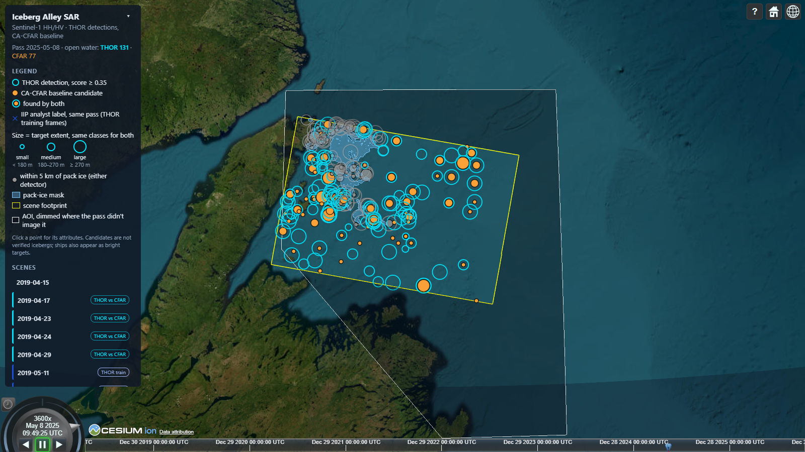
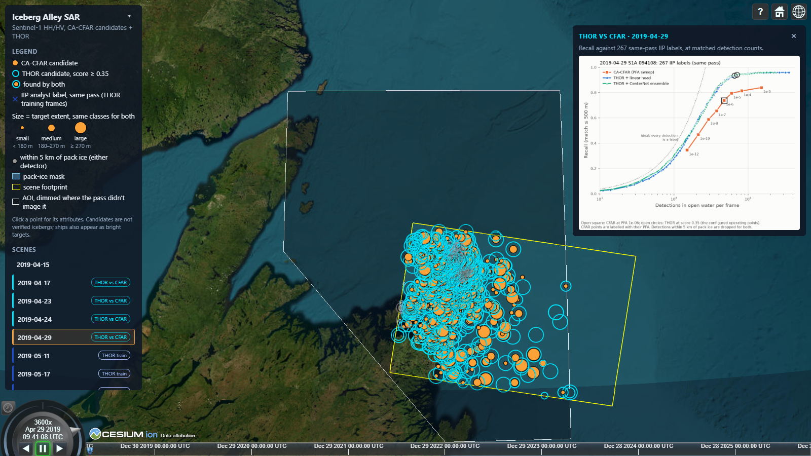
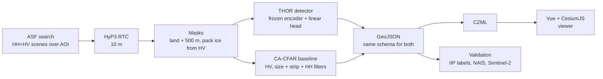
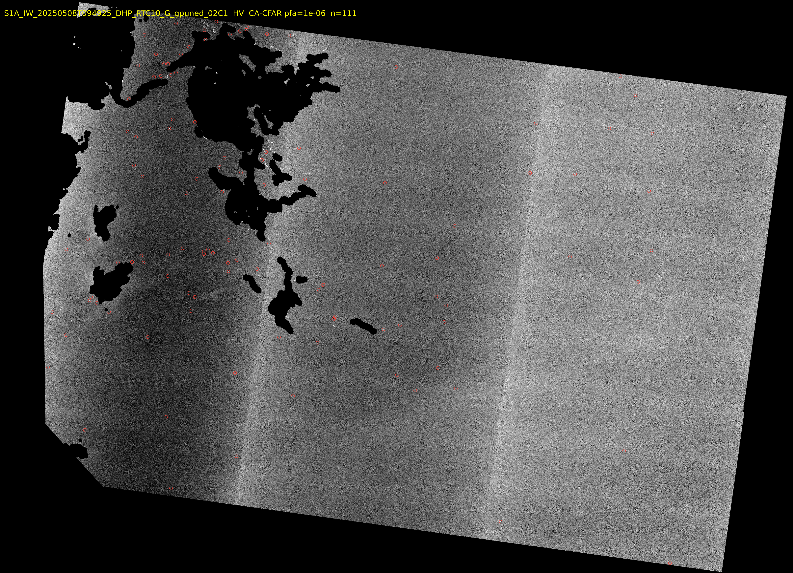
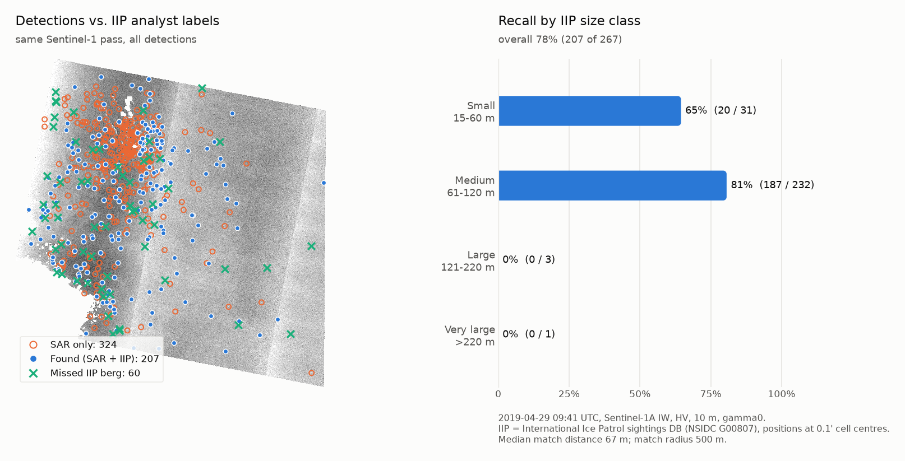

# Iceberg Alley SAR

Detecting icebergs off Newfoundland & Labrador in Sentinel-1 radar imagery with **THOR**, a SAR foundation model, benchmarked against a classical CA-CFAR detector, and showing them on an interactive CesiumJS globe with a timeline.

**Live demo:** https://natali-kovalski.github.io/iceberg-alley-sar/



**In short:** the frozen THOR foundation model with a 769-parameter linear head finds **84% of the icebergs that International Ice Patrol analysts marked** on four held-out Sentinel-1 passes (431 of 512). A well-tuned classical CA-CFAR detector finds **74%** at the same number of detections. THOR finds 11 of the 14 large bergs (> 120 m), where the CFAR finds 4. The classical SAR pipeline still matters: calibration, the land mask and the pack-ice mask come from it, and THOR depends on them.

## The problem

Every spring, icebergs calved from Greenland glaciers drift south along the Labrador Current into "Iceberg Alley", the stretch of ocean off Newfoundland's northeast coast. They are a hazard to shipping, fishing vessels and offshore platforms on the Grand Banks. Aircraft reconnaissance is expensive and limited by weather. Synthetic aperture radar (SAR) sees through cloud and darkness, so satellite SAR is the main tool for wide-area iceberg surveillance.

This project builds that pipeline on free Copernicus Sentinel-1 data, for the coast from Bonavista to St. Anthony. It asks whether a remote-sensing foundation model, used off the shelf with a tiny trained head, beats the classical detector, and checks both against the ground truth that exists.

## Results

Both detectors ran on four held-out April 2019 passes with same-pass IIP analyst labels (512 bergs), with identical land and pack-ice masks and the same 500 m one-to-one matching. Precision can't be measured without AIS ship positions, so the comparison is **recall at the same number of detections**: the CFAR is swept over its false-alarm rate, THOR over its score, and both are read at the CFAR's detection count at PFA 10⁻⁶. Nothing was tuned on these passes.

| Recall at the same detection count | **THOR** (linear head) | CA-CFAR (baseline) |
|---|---|---|
| **4 passes pooled, 512 labels** | **0.84** (431) | 0.74 (380) |
| 2019-04-29 (267 labels) | **0.89** | 0.74 |
| Large bergs, > 120 m (14) | **11 of 14** | 4 of 14 |
| Medium bergs, 61–120 m (425) | **0.87** | 0.76 |
| Small bergs, 15–60 m (73) | 0.71 | 0.71 |
| Highest recall, any setting | 0.92 | 0.83, with ~5× THOR's detections |
| Compute per 10 m scene | GPU, 8–15 min (laptop RTX 3070) | CPU |


- **THOR leads on every pass**, by 0 to 15 points. It reaches the CFAR's pooled recall with about 28% fewer detections.
- **The CFAR saturates.** Loosening its false-alarm rate from 10⁻⁵ to 10⁻³ adds thousands of detections and few bergs. THOR keeps climbing.
- **Large bergs:** the CFAR sees them (30+ dB above the sea), then its 300 m ice-strip rule throws them away. THOR has no such rule.
- **Small bergs are a tie.** A THOR token covers 80 m, which is coarse for a 20 m target. A 4×4 patch run is the next test.
- **Caveats.** It is one month of one year, and the passes share some bergs. THOR learned from IIP analyst labels, so part of the gap may be agreement with their labelling style. Neither detector's precision is known.

The viewer shows 32 scenes (28 passes) from spring 2019, 2020 and 2025 and autumn 2026, with THOR and CFAR as separate layers. Each test pass opens its own recall chart:



The full comparison, including where THOR doesn't beat the CFAR, is in [docs/thor-vs-cfar.md](docs/thor-vs-cfar.md).

## Data

| Source | Use |
|---|---|
| **Sentinel-1 IW GRD** (Copernicus, via [ASF](https://search.asf.alaska.edu)) | Radar imagery, HH + HV polarization |
| **ASF HyP3 RTC** | Terrain-corrected, calibrated GeoTIFFs at 10 m with an incidence-angle map (gamma0 for the pipeline, sigma0 for THOR training frames) |
| **[THOR](https://huggingface.co/FM4CS)** (FM4CS, Apache 2.0) | Frozen foundation-model encoder (THOR Tiny), loaded through TerraTorch |
| **IIP Iceberg Sightings Database** (NSIDC G00807) | Training labels for the THOR head (2019–2020) and test labels (April 2019). The database ends with the 2021 season |
| **OpenStreetMap land polygons + rock/islet nodes** (Overpass API) | Land mask, buffered 500 m to remove coastal clutter |
| **NAIS daily iceberg chart** (IIP + Canadian Ice Service) | Count check per 1° square |
| **Sentinel-2 L2A** (Earth Search) | Optical cross-check |

## Method



A few terms, briefly:
- **Backscatter** is how much radar energy a surface returns to the satellite. Calm water reflects energy away, so it is dark. An iceberg's edges and facets reflect energy back, so it is bright.
- **Polarization:** HH sends and receives horizontally polarized waves, HV sends horizontal and receives vertical. Sea clutter is much weaker in HV, so icebergs stand out more there.
- **Speckle** is the grainy noise in every SAR image. **ENL** (equivalent number of looks) measures how strong it is.
- **Foundation model:** a large network pretrained on a huge amount of unlabelled imagery. Its features are general enough that a very small head, trained on a few hundred labels, can solve a new task.
- **CFAR** (constant false alarm rate) compares each pixel with its local background instead of using a fixed threshold, so the false-alarm rate stays the same in calm and rough water.
- **dB vs. linear:** the CFAR runs on linear power, THOR on dB. Reported values and displays use decibels.

### THOR detector

Following Forgaard et al., "Efficient iceberg detection in Sentinel-1 imagery using the THOR foundation model" (IGARSS 2026):

1. **Input.** THOR has native HH/HV embeddings and was pretrained on sigma0 in dB. HyP3 gives gamma0, so it is converted with sigma0 = gamma0 · cos(incidence) and normalized with THOR's statistics. Land and pack ice come from the classical masks below.
2. **Frozen encoder.** THOR Tiny with 8×8 patches: a 512×512 crop at 10 m gives 64×64 tokens of 192 features. The encoder is never fine-tuned. Features from four of its blocks are cached once, so training the head is fast.
3. **Head.** A linear layer on those features (4 × 192 + 1 = **769 parameters**) outputs an iceberg heatmap. A CenterNet-style MLP head was tried too; it matched but never beat the linear head.
4. **Training data.** IIP analyst labels marked on the same Sentinel-1 pass, on 20 HH/HV frames from 2019–2020, with **all of April 2019 held out** (the same bergs show up on nearby passes). Labels are moved to their 0.1' cell centre, snapped to the HH peak and drawn as Gaussians: 723 train / 154 val crops. Heads are chosen on year folds (2019 ↔ 2020), never on the test passes.
5. **Inference.** Sliding window with overlap over the full scene, peak extraction, and peaks kept only on unmasked water. The output is the CFAR's GeoJSON schema plus `detector` and `score`, so both run through the same validation and viewer. The viewer shows peaks with score ≥ 0.35.


*THOR heatmaps on 2020 validation crops: IIP labels (red circles), THOR peaks (green ×), pack ice (blue outline). In the two ice-edge crops of the bottom row, THOR lights up the pack ice, which is why it needs the classical pack-ice mask.*

### Classical pipeline and CA-CFAR baseline

Parameters are in [config.yaml](config.yaml), with lengths in metres so tuning carries over between 10 m and 20 m pixels.

1. **Masks** (used by both detectors). Land from OSM, buffered 500 m. OSM land polygons only cover coastlines mapped as lines, so the thousands of offshore rocks and islets mapped as single points (many from the CanVec import) are added too. Pack ice from HV statistics on 200 m cells: pack ice is bright and uniform, open water is dark, and a cell with an iceberg is spiky. Pack ice is masked with a 1 km buffer, and each detection keeps its distance to the ice.
2. **CA-CFAR on HV.** The background is the mean of a ring (400 m half-width, minus a 100 m guard window that keeps the target's own energy out). The threshold comes from a false-alarm rate of 10⁻⁶ under a gamma speckle model, with ENL estimated from the scene. HyP3 removes the HV thermal noise floor, so open-water HV sits at −30 to −40 dB with ENL below 1. A textbook ENL would set the threshold far too low.
3. **Connected components** of 2 px to 0.8 km². Components within 200 m of land, ice or nodata are dropped.
4. **Ice-strip rejection.** Each target is grown to the region more than 4 dB above background. Structures longer than 300 m are treated as thin strips of loose ice. This is the rule that also drops large bergs.
5. **HH co-pol check.** A target must also be 6 dB above background in HH. 10 m IW GRD is oversampled (true resolution about 20 m), so HV speckle grains span about 2×2 px and pass the size filter. Real targets are bright in both polarizations.
6. **Output:** GeoJSON points with area, extent, structure length, peak and mean dB per band, contrast, incidence angle and distance to pack ice. CZML for the viewer, with one time interval per scene.
7. **Static targets.** Bergs drift hundreds of metres or more between passes; a rock returns to the same spot within the ~10–30 m geolocation error. Targets detected within 50 m of each other on three or more dates are treated as unmapped rocks or islets. They are listed in `data/outputs/static_targets_HV.geojson` and left out of the viewer (the detection files keep them).


*HV backscatter on 2025-05-08 with land and pack ice masked (black) and CFAR detections circled in red. The vertical brightness steps are the three IW sub-swaths.*

How the CFAR was tuned is in [docs/milestone2-cfar-findings.md](docs/milestone2-cfar-findings.md).

## Quickstart

Requires Python 3.11+, Node 20+, and a free [NASA Earthdata](https://urs.earthdata.nasa.gov) account. In Earthdata, go to Applications > Authorized Apps and approve **ASF HyP3**, otherwise HyP3 refuses API logins. THOR needs a CUDA GPU.

```powershell
git clone https://github.com/natali-kovalski/iceberg-alley-sar.git
cd iceberg-alley-sar
py -3.11 -m venv .venv
.venv\Scripts\Activate.ps1
pip install -e ".[dev]"
copy .env.example .env             # fill in EARTHDATA_USERNAME / EARTHDATA_PASSWORD
python -m iceberg_sar.cli init-dirs
```

Run the classical pipeline for the demo dates (scene search, HyP3 processing, masks, CFAR baseline):

```powershell
python -m iceberg_sar.cli run --start 2025-05-01 --end 2025-05-15 --dry-run   # plan + credit estimate
python -m iceberg_sar.cli run --start 2025-05-01 --end 2025-05-15
```

`run` does the following:
1. Searches ASF for HH+HV scenes over [aoi.geojson](aoi.geojson) and keeps the `run.max_scenes` (default 3) that cover the AOI best.
2. Orders HyP3 RTC jobs, waits for them (often 30–60 min) and downloads them. Each 10 m scene costs 60 of the monthly HyP3 credits, and `--dry-run` shows the total first.
3. Builds the land mask (one-time ~900 MB OSM download), preprocesses each scene (masks), runs the CFAR, and writes `data/outputs/iceberg_alley.czml`. The CZML holds every scene processed so far, not just this run's dates, so the viewer accumulates seasons.

Re-runs reuse everything on disk: downloaded products, masked rasters and detections. Use `--force` to redo preprocessing and detection after changing parameters. Without `--start`/`--end`, the dates come from `search` in `config.yaml`.

Then run THOR on the same scenes and open the viewer. `run` doesn't include THOR yet, and the trained head isn't distributed, so the first time you train it (see [THOR training](#thor-training) below):

```powershell
pip install -e .[ml,thor] --extra-index-url https://download.pytorch.org/whl/cu124
python -m iceberg_sar.cli thor-detect data\raw\<product_dir> [<product_dir> ...] --head linear
python -m iceberg_sar.cli czml       # picks up the THOR detections next to the CFAR ones
python -m iceberg_sar.cli publish    # per-scene CZML + manifest -> viewer/public/data/
cd viewer
npm install
npm run dev                          # http://localhost:5173
```

In the viewer:
- Scrub the timeline to step through passes, and click a target to see its attributes.
- THOR detections are cyan rings (score ≥ 0.35), CFAR detections orange dots. Both share one size scale, and the THOR layer can be toggled. Targets within 5 km of pack ice are grey (likely ice floes), and a checkbox hides them.
- Passes marked "THOR vs CFAR" open the recall chart for that pass.
- Toggle the scene footprint and the pack-ice mask. The "?" button explains what the points are.
- The basemap is Esri World Imagery, so no Cesium ion token is needed. `npm run build` gives a static site in `viewer/dist/` for `/iceberg-alley-sar/` (GitHub Pages); set `VIEWER_BASE=/` to host it at a root.

## THOR training

Needs a CUDA GPU and `pip install -e .[ml,thor]` (see `pyproject.toml`). Training frames are ordered as HyP3 RTC **sigma0**, budgeted against the monthly HyP3 credits.

```powershell
python -m iceberg_sar.cli thor-smoke                      # PCA of frozen features on one crop
python -m iceberg_sar.cli thor-scenes                     # 2019–2020 HH/HV frames with same-pass IIP labels
python -m iceberg_sar.cli thor-order; python -m iceberg_sar.cli thor-download
python -m iceberg_sar.cli thor-chips                      # crops + Gaussian targets -> data/thor/chips/
python -m iceberg_sar.cli thor-features                   # cache frozen-encoder features
python -m iceberg_sar.cli thor-train                      # linear + CenterNet heads, folds + final
python -m iceberg_sar.cli thor-overlays                   # heatmaps on validation crops
python -m iceberg_sar.cli thor-compare --sweep            # THOR vs CFAR on the test passes: figure + tables
```

## Updating the live viewer

The live viewer is a static site on GitHub Pages. Python never runs in CI: the data is built locally and committed.

```powershell
python -m iceberg_sar.cli run --start <date> --end <date>       # process new scenes
python -m iceberg_sar.cli thor-detect data\raw\<product_dir>    # THOR on each new scene
python -m iceberg_sar.cli czml; python -m iceberg_sar.cli publish
git add viewer/public/data; git commit -m "Viewer: add <dates>"; git push
```

A push to `main` that touches `viewer/**` triggers [.github/workflows/pages.yml](.github/workflows/pages.yml), which builds the viewer and deploys it. `publish` rebuilds `viewer/public/data/` from scratch on each run and copies derived products only: CZML, the THOR vs CFAR figures and `manifest.json`, never raw rasters, Kaggle chips, model weights or cached features. It fails if a file exceeds `publish.max_file_mb` (25) or the folder exceeds `publish.max_total_mb` (300). The viewer loads whatever the manifest lists, so no scene names are hardcoded.

## Individual steps

`run` chains the classical steps, and each can be run on its own (`--help` on any command):

```powershell
python -m iceberg_sar.cli search --pol HH+HV                 # scene list + footprints -> data/outputs/
python -m iceberg_sar.cli order <granule>                    # one HyP3 RTC job (skips if already ordered)
python -m iceberg_sar.cli download                           # wait, download, unzip to data/raw/
python -m iceberg_sar.cli land-mask                          # --force rebuilds it
python -m iceberg_sar.cli preprocess data\raw\<product_dir>  # masked linear rasters + dB quicklooks
python -m iceberg_sar.cli detect data\raw\<product_dir>      # CFAR on HV; --band HH to compare
python -m iceberg_sar.cli thor-detect data\raw\<product_dir> # THOR on the masked scene (GPU)
python -m iceberg_sar.cli czml --start 2025-05-01 --end 2025-05-15
python -m iceberg_sar.cli publish                            # viewer/public/data/ from data/outputs/ only
python -m iceberg_sar.cli figures                            # regenerate docs/img (scenes in `figures:` in config.yaml)
```

Outputs (all under the gitignored `data/`):
- `data/interim/<product>/<product>_<POL>_masked.tif`: linear power, masked areas NaN. The input of both detectors.
- `data/outputs/quicklooks/<product>_<POL>_db.png`: dB quicklook.
- `data/outputs/detections/<product>_thor-linear_detections.geojson`: THOR detections (EPSG:4326), every peak with score ≥ 0.1.
- `data/outputs/detections/<product>_HV_detections.{geojson,png,json}`: CFAR detections, overlay and run summary.
- `data/outputs/static_targets_HV.geojson`: targets seen at the same spot on several dates (rocks, islets), left out of the viewer.
- `data/land/osm_land_aoi.gpkg`, `osm_land_points_aoi.gpkg`: land mask and the OSM rock/islet points added to it.
- `data/models/thor/`: trained heads. `data/thor/`: chips and cached features.

## Validation

```powershell
python -m iceberg_sar.cli iip-sightings 2019                          # IIP sightings season
python -m iceberg_sar.cli validate-points data\raw\<product_dir> --truth iip-satellite --no-open-water
python -m iceberg_sar.cli ground-truth 2025-05-08                     # NAIS chart GIFs
python -m iceberg_sar.cli validate data\raw\<product_dir> --counts validation\nais_20250508_counts.csv
python -m iceberg_sar.cli s2-targets data\raw\<product_dir>           # Sentinel-2 optical targets
python -m iceberg_sar.cli validate-points data\raw\<product_dir> --truth s2
```

- Point matching is one-to-one (Hungarian assignment) within 500 m. When the truth is not simultaneous with the radar pass, a common drift offset is estimated and checked against chance.
- The scores use IIP sightings marked on the same Sentinel-1 pass. That has no drift, but it is not independent: the analysts looked at the same radar image. Aircraft sightings (5–7 h later) and Sentinel-2 (loose sea ice in April, bergs mostly inshore in June) were inconclusive.
- The NAIS chart is published only as an image. The counts per 1° square are hand-transcribed in [validation/](validation/). For the three spring 2025 passes, open-water CFAR detections are within 2–4× of the chart estimate: a sanity check, not a measurement.
- **About the earlier 78%.** Before THOR, the CFAR was validated on 2019-04-29 alone: it matched 207 of 267 labels (78%, median offset 67 m). That count includes detections near pack ice. The THOR comparison drops detections within 5 km of pack ice for both detectors, which gives the CFAR 0.74 on the same pass. Use 0.74 when comparing with THOR.



The details are in [docs/validation-findings.md](docs/validation-findings.md).

## Limitations

- **Precision is unknown for both detectors.** At the matched count, the CFAR has 546 and THOR 495 detections without an IIP label on the test passes. They are a mix of unrecorded bergs, fishing vessels and false alarms, in unknown proportions. Separating them needs AIS vessel positions.
- **THOR depends on the classical pipeline.** On its own it fires on pack ice (34–82% of its peaks on icy passes fall in the pack-ice mask), so it needs the HV pack-ice mask. It also needs a GPU, and `run` doesn't include it yet.
- **One month of one year.** The test passes are all April 2019, at incidence angles of 35–47°. Near range is untested.
- **Small bergs** are a tie (0.71). THOR's 80 m patches are coarse for them, and the CFAR removes single-pixel targets with its 2 px minimum.
- **The CFAR drops large bergs** with its 300 m ice-strip rule (4 of 14 found). A shape-based strip test could fix that.
- **Sea state matters.** On rougher days the HV background rises 3–4 dB and small bergs lose contrast.
- **Near pack ice, many detections are ice floes.** They are flagged by distance to ice, not removed.
- **CA-CFAR with gamma speckle** understates the heavy tails of real sea clutter, so its actual false-alarm rate is higher than 10⁻⁶. OS-CFAR or K-distribution CFAR would be a stronger baseline (`cfar.variant` has a slot for it).
- **Static-target filter trade-off.** A berg grounded at the same spot for three or more passes is removed with the rocks. An unmapped rock seen on only two dates stays in. `static_targets.min_dates` and `min_span_days` set the balance.
- **No ship/iceberg discrimination** you can rely on (see the experimental classifier below).

## Experimental: iceberg vs. ship classifier

A small CNN trained on the Kaggle [Statoil/C-CORE Iceberg Classifier Challenge](https://www.kaggle.com/c/statoil-iceberg-classifier-challenge) chips adds `iceberg_prob` to each CFAR detection. On Kaggle it reaches 0.23 log loss (5-fold out-of-fold, 90% accuracy). On our scenes it is mostly unsure, and two model variants agree on only 70% of open-water targets. **Use it as a sort key for review, not as a label.**

```powershell
pip install -e .[ml]                           # torch, scikit-learn, py7zr
# put train.json from Kaggle in data/kaggle/ (competition terms: don't redistribute)
python -m iceberg_sar.cli train-classifier
python -m iceberg_sar.cli classify data\raw\<product_dir>
```

<details>
<summary>How the chips were matched to Kaggle, and why the output is a weak hint</summary>

- *Resolution matches.* Kaggle chips have the same speckle correlation (lag-1 ≈ 0.6) and ENL (≈ 4) as our 10 m RTC, and 1,470 of 1,471 incidence angles fall in the IW swath (29–46°). Chips are cut at native 10 m.
- *Radiometry doesn't match, so it is corrected.* HyP3 gives gamma0 and Kaggle is sigma0, so chips are multiplied by cos(incidence). HyP3 also removes the HV noise floor (calm sea ≈ −40 dB) while Kaggle keeps it (−24 to −29 dB), so speckled noise is added to match the Kaggle HV background at each incidence angle.
- Kaggle's missing incidence angles are all ships. They are imputed to the mean so the model can't learn that leak.
- On Kaggle, 79% of chips get p < 0.2 or > 0.8. On our 343 open-water detections, only 26% do.
- Most of our targets are 2–10 px, against a Kaggle median of about 74 px above background, so small targets are out of distribution.
- Shifting the HV noise floor by ±2 dB changes p by 0.07 on average and flips 9–13% of labels.
- Near pack ice, chips contain ice texture Kaggle never shows, so p is meaningless there.

</details>

## Repository layout

- `config.yaml`: all parameters (`thor:` block for the foundation model). `aoi.geojson`: the area of interest (EPSG:4326).
- `src/iceberg_sar/thor/`: the THOR detector (`encoder.py`, `chips.py`, `targets.py`, `heads.py`, `train.py`, `infer.py`, `compare.py`).
- `src/iceberg_sar/`: the classical pipeline. `pipeline.py` is the end-to-end `run`, `seaice.py` + `landmask.py` the masks, `cfar.py` + `detections.py` the CFAR baseline, `pointval.py` + `matching.py` the validation, `export_czml.py` the viewer export, `publish.py` the web data, `classify/` the experimental CNN.
- `viewer/`: Vue 3 + Vite + CesiumJS (`src/scene.ts` holds the Cesium logic). `viewer/public/data/` is the published data (committed).
- `.github/workflows/pages.yml`: builds and deploys the viewer to GitHub Pages.
- `docs/`: findings write-ups ([thor-vs-cfar.md](docs/thor-vs-cfar.md), [validation-findings.md](docs/validation-findings.md), [milestone2-cfar-findings.md](docs/milestone2-cfar-findings.md)), figures and presentations. `validation/`: transcribed NAIS chart counts.
- `tests/`: pytest suite (`pytest`). `data/`: everything downloaded or generated (gitignored).

## Data terms

- Contains modified Copernicus Sentinel data (2019–2026), via ASF DAAC and Earth Search (Element 84).
- THOR weights: FM4CS, Apache 2.0, downloaded from Hugging Face at run time (not redistributed).
- Iceberg sightings: International Ice Patrol Iceberg Sightings Database, NSIDC G00807.
- Iceberg charts: North American Ice Service (International Ice Patrol + Canadian Ice Service).
- Land polygons: © OpenStreetMap contributors, ODbL.
- Kaggle Statoil/C-CORE chips: used under the competition terms and not redistributed.

## License

The code is released under the [MIT License](LICENSE). It covers the code and docs in this repository only. The data sources above keep their own terms.
