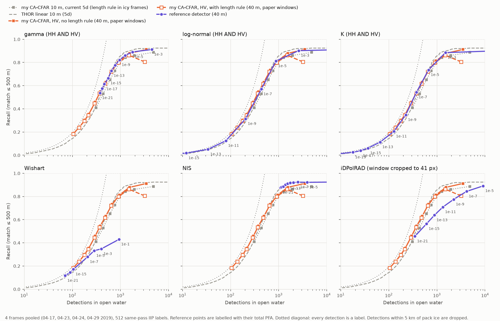

# Milestone 2b: reference CFAR detectors vs my CA-CFAR on IIP labels, April 2019 frames

Generated by `python -m iceberg_sar.cli bench-iw-sweep` and `bench-iw-compare`.
Same scoring as 5d (`thor-compare`), so the 40 m curves sit next to 5d's 10 m ones.

## Setup

- HyP3 RTC frame (gamma0, HH/HV) multilooked 4x4 to **40 m** (mean of linear intensity), so the paper's windows fit the library (9 / 13 px). Masks: land + 500 m, pack ice, nodata, as in 5d.
- Reference detectors: the library through `external/cfar_runner`, paper windows (360 / 520 m), HH AND HV merge, per-band ENL for gamma / K, objects of 2-500 px.
- My CA-CFAR: HV, co-pol check, ENL estimated on the 40 m HV. Variants: **without the length rule, paper windows**, **with the length rule, paper windows**, **without the length rule, own windows**, **with the length rule, own windows**. Paper windows = the reference detectors' (360 / 520 m), so paper windows without the length rule is the like-for-like run (the reference detectors have no such rule). Own windows = `cfar.guard_m` / `background_m`, as at 10 m. Unlabelled CA-CFAR rows below use the paper windows.
- Total PFA: 1e-21, 1e-19, 1e-17, 1e-15, 1e-13, 1e-11, 1e-09, 1e-07, 1e-05, 1e-03, 1e-01; a detector stops after the first PFA with more than 5000 objects.
- Truth: same-pass IIP labels where the SAR is valid. Detections within 5 km of pack ice dropped. One-to-one matching at 500 m.
- Precision isn't measurable without AIS: compare **recall at matched detection counts**, interpolated in log(detections) between PFA points.
## S1A_IW_20190429T094108_DHP_RTC10_G_gpuned_671B

- Labels compared: 267. ENL at 40 m (open-water box): HH 5.964, HV 1.823. My CA-CFAR: ENL 1.884, guard / background half-widths (px): paper 4 / 6, own 2 / 10.

### Recall at matched detection counts

| Detector | @250 | @500 | @1000 | Detections covered | PFAs run |
|---|---|---|---|---|---|
| gamma (HH AND HV) | 0.64 | 0.87 | 0.93 | 189-336381 | 11 |
| log-normal (HH AND HV) | 0.60 | 0.85 | 0.93 | 1-413932 | 11 |
| K (HH AND HV) | 0.65 | 0.84 | 0.92 | 4-495796 | 11 |
| Wishart |  |  |  | 13-92 | 11 |
| NIS |  |  | 0.96 | 597-9957 | 10 |
| iDPolRAD (window cropped to 41 px) | 0.62 | 0.87 | 0.92 | 134-5943 | 10 |
| my CA-CFAR, HV, no length rule | 0.65 | 0.84 | 0.91 | 53-1793 | 11 |
| my CA-CFAR, HV, with length rule | 0.64 | 0.83 | 0.87 | 51-1705 | 11 |
| my CA-CFAR, HV, no length rule, own windows | 0.64 | 0.86 | 0.92 | 69-1757 | 11 |
| my CA-CFAR, HV, with length rule, own windows | 0.63 | 0.84 | 0.84 | 65-1631 | 11 |
| my CA-CFAR 10 m, no length rule | 0.58 | 0.83 | 0.92 | 173-1568 | 5d |
| my CA-CFAR 10 m, with length rule (old 5d) | 0.53 | 0.75 | 0.82 | 151-1513 | 5d |
| THOR linear 10 m (5d) | 0.66 | 0.90 | 0.95 | 0-3561 | 5d |

Blank: the curve doesn't reach that count. 10 m rows (own windows): the CA-CFAR without the length rule is this sweep's `cacfar-nolength-10m` (current 5d's curve on open-water frames); with the rule, the old 5d run with the rule always on (`ref_5d_dir`; current 5d's curve on icy frames); THOR, 5d's score sweep.

### Recall by IIP size, near 500 detections

| Detector | PFA | Detections | small 15-60 m (n=31) | medium 61-120 m (n=232) | large >120 m (n=4) |
|---|---|---|---|---|---|
| gamma (HH AND HV) | 1e-09 | 492 | 19/31 | 209/232 | 4/4 |
| log-normal (HH AND HV) | 1e-05 | 466 | 19/31 | 201/232 | 4/4 |
| K (HH AND HV) | 1e-05 | 371 | 15/31 | 192/232 | 4/4 |
| Wishart | 1e-01 | 92 | 4/31 | 72/232 | 2/4 |
| NIS | 1e-21 | 597 | 29/31 | 218/232 | 4/4 |
| iDPolRAD (window cropped to 41 px) | 1e-07 | 495 | 22/31 | 207/232 | 4/4 |
| my CA-CFAR, HV, no length rule | 1e-05 | 480 | 17/31 | 203/232 | 4/4 |
| my CA-CFAR, HV, with length rule | 1e-05 | 462 | 17/31 | 200/232 | 3/4 |
| my CA-CFAR, HV, no length rule, own windows | 1e-05 | 502 | 18/31 | 208/232 | 4/4 |
| my CA-CFAR, HV, with length rule, own windows | 1e-05 | 476 | 18/31 | 204/232 | 1/4 |
| my CA-CFAR 10 m, no length rule | 1e-06 | 508 | 20/31 | 198/232 | 4/4 |
| my CA-CFAR 10 m, with length rule (old 5d) |  |  | 20/31 | 177/232 | 0/4 |
| THOR linear 10 m (5d) |  |  | 22/31 | 211/232 | 4/4 |

10 m rows without a PFA: 5d's operating points (CA-CFAR at `cfar.pfa`, THOR at the same detection count).

Figure (local, gitignored): `data/benchmark/iw40/S1A_IW_20190429T094108_DHP_RTC10_G_gpuned_671B/recall_vs_detections.png`. Tables: `sweep_scored.csv`, `recall_at_matched_counts.csv`, `size_breakdown.csv` next to it.

## S1A_IW_20190424T093305_DHP_RTC10_G_gpuned_132E

- Labels compared: 49. ENL at 40 m (open-water box): HH 9.385, HV 2.726. My CA-CFAR: ENL 2.788, guard / background half-widths (px): paper 4 / 6, own 2 / 10.

### Recall at matched detection counts

| Detector | @250 | @500 | @1000 | Detections covered | PFAs run |
|---|---|---|---|---|---|
| gamma (HH AND HV) | 0.98 | 0.98 | 0.99 | 26-100761 | 11 |
| log-normal (HH AND HV) | 0.95 | 0.95 | 0.96 | 0-116086 | 11 |
| K (HH AND HV) | 0.93 | 0.94 | 0.95 | 2-127227 | 11 |
| Wishart |  |  |  | 50-79 | 11 |
| NIS | 1.00 | 1.00 | 1.00 | 55-118717 | 11 |
| iDPolRAD (window cropped to 41 px) | 0.96 | 0.97 | 0.98 | 90-7453 | 9 |
| my CA-CFAR, HV, no length rule |  |  |  | 11-87 | 11 |
| my CA-CFAR, HV, with length rule |  |  |  | 11-80 | 11 |
| my CA-CFAR, HV, no length rule, own windows |  |  |  | 12-90 | 11 |
| my CA-CFAR, HV, with length rule, own windows |  |  |  | 11-78 | 11 |
| my CA-CFAR 10 m, no length rule |  |  |  | 21-103 | 5d |
| my CA-CFAR 10 m, with length rule (old 5d) |  |  |  | 18-100 | 5d |
| THOR linear 10 m (5d) | 0.98 | 1.00 |  | 0-594 | 5d |

Blank: the curve doesn't reach that count. 10 m rows (own windows): the CA-CFAR without the length rule is this sweep's `cacfar-nolength-10m` (current 5d's curve on open-water frames); with the rule, the old 5d run with the rule always on (`ref_5d_dir`; current 5d's curve on icy frames); THOR, 5d's score sweep.

### Recall by IIP size, near 500 detections

| Detector | PFA | Detections | small 15-60 m (n=15) | medium 61-120 m (n=31) | large >120 m (n=3) |
|---|---|---|---|---|---|
| gamma (HH AND HV) | 1e-03 | 160 | 15/15 | 30/31 | 3/3 |
| log-normal (HH AND HV) | 1e-03 | 82 | 14/15 | 29/31 | 3/3 |
| K (HH AND HV) | 1e-03 | 65 | 13/15 | 29/31 | 3/3 |
| Wishart | 1e-01 | 79 | 15/15 | 31/31 | 3/3 |
| NIS | 1e-03 | 967 | 15/15 | 31/31 | 3/3 |
| iDPolRAD (window cropped to 41 px) | 1e-13 | 422 | 14/15 | 30/31 | 3/3 |
| my CA-CFAR, HV, no length rule | 1e-01 | 87 | 15/15 | 31/31 | 3/3 |
| my CA-CFAR, HV, with length rule | 1e-01 | 80 | 14/15 | 26/31 | 2/3 |
| my CA-CFAR, HV, no length rule, own windows | 1e-01 | 90 | 15/15 | 31/31 | 3/3 |
| my CA-CFAR, HV, with length rule, own windows | 1e-01 | 78 | 15/15 | 23/31 | 1/3 |
| my CA-CFAR 10 m, no length rule | 1e-03 | 103 | 14/15 | 30/31 | 3/3 |
| my CA-CFAR 10 m, with length rule (old 5d) |  |  | 10/15 | 26/31 | 1/3 |
| THOR linear 10 m (5d) |  |  | 11/15 | 28/31 | 1/3 |

10 m rows without a PFA: 5d's operating points (CA-CFAR at `cfar.pfa`, THOR at the same detection count).

Figure (local, gitignored): `data/benchmark/iw40/S1A_IW_20190424T093305_DHP_RTC10_G_gpuned_132E/recall_vs_detections.png`. Tables: `sweep_scored.csv`, `recall_at_matched_counts.csv`, `size_breakdown.csv` next to it.

## S1B_IW_20190423T094026_DHP_RTC10_G_gpuned_A784

- Labels compared: 150. ENL at 40 m (open-water box): HH 4.839, HV 1.457. My CA-CFAR: ENL 1.519, guard / background half-widths (px): paper 4 / 6, own 2 / 10.

### Recall at matched detection counts

| Detector | @250 | @500 | @1000 | Detections covered | PFAs run |
|---|---|---|---|---|---|
| gamma (HH AND HV) | 0.80 | 0.84 | 0.85 | 134-278897 | 11 |
| log-normal (HH AND HV) | 0.78 | 0.85 | 0.85 | 0-358430 | 11 |
| K (HH AND HV) | 0.77 | 0.84 | 0.84 | 2-484034 | 11 |
| Wishart |  |  |  | 6-71 | 11 |
| NIS |  | 0.86 | 0.86 | 351-10998 | 10 |
| iDPolRAD (window cropped to 41 px) | 0.78 | 0.83 | 0.84 | 83-5151 | 10 |
| my CA-CFAR, HV, no length rule | 0.79 | 0.85 | 0.86 | 35-1048 | 11 |
| my CA-CFAR, HV, with length rule | 0.77 | 0.83 | 0.83 | 35-1027 | 11 |
| my CA-CFAR, HV, no length rule, own windows | 0.78 | 0.84 | 0.86 | 47-1018 | 11 |
| my CA-CFAR, HV, with length rule, own windows | 0.77 | 0.82 |  | 47-997 | 11 |
| my CA-CFAR 10 m, no length rule | 0.78 | 0.85 | 0.85 | 87-1160 | 5d |
| my CA-CFAR 10 m, with length rule (old 5d) | 0.77 | 0.82 | 0.83 | 87-1150 | 5d |
| THOR linear 10 m (5d) | 0.80 | 0.86 | 0.86 | 0-1827 | 5d |

Blank: the curve doesn't reach that count. 10 m rows (own windows): the CA-CFAR without the length rule is this sweep's `cacfar-nolength-10m` (current 5d's curve on open-water frames); with the rule, the old 5d run with the rule always on (`ref_5d_dir`; current 5d's curve on icy frames); THOR, 5d's score sweep.

### Recall by IIP size, near 500 detections

| Detector | PFA | Detections | small 15-60 m (n=24) | medium 61-120 m (n=119) | large >120 m (n=7) |
|---|---|---|---|---|---|
| gamma (HH AND HV) | 1e-05 | 418 | 22/24 | 98/119 | 6/7 |
| log-normal (HH AND HV) | 1e-03 | 497 | 22/24 | 100/119 | 6/7 |
| K (HH AND HV) | 1e-03 | 376 | 22/24 | 98/119 | 6/7 |
| Wishart | 1e-01 | 71 | 6/24 | 47/119 | 2/7 |
| NIS | 1e-11 | 510 | 22/24 | 101/119 | 6/7 |
| iDPolRAD (window cropped to 41 px) | 1e-05 | 435 | 21/24 | 97/119 | 6/7 |
| my CA-CFAR, HV, no length rule | 1e-03 | 388 | 22/24 | 99/119 | 6/7 |
| my CA-CFAR, HV, with length rule | 1e-03 | 383 | 22/24 | 98/119 | 4/7 |
| my CA-CFAR, HV, no length rule, own windows | 1e-03 | 378 | 20/24 | 99/119 | 6/7 |
| my CA-CFAR, HV, with length rule, own windows | 1e-03 | 370 | 20/24 | 98/119 | 4/7 |
| my CA-CFAR 10 m, no length rule | 1e-04 | 473 | 22/24 | 99/119 | 6/7 |
| my CA-CFAR 10 m, with length rule (old 5d) |  |  | 21/24 | 94/119 | 3/7 |
| THOR linear 10 m (5d) |  |  | 18/24 | 99/119 | 6/7 |

10 m rows without a PFA: 5d's operating points (CA-CFAR at `cfar.pfa`, THOR at the same detection count).

Figure (local, gitignored): `data/benchmark/iw40/S1B_IW_20190423T094026_DHP_RTC10_G_gpuned_A784/recall_vs_detections.png`. Tables: `sweep_scored.csv`, `recall_at_matched_counts.csv`, `size_breakdown.csv` next to it.

## S1A_IW_20190417T094107_DHP_RTC10_G_gpuned_EDB4

- Labels compared: 46. ENL at 40 m (open-water box): HH 8.189, HV 3.216. My CA-CFAR: ENL 3.333, guard / background half-widths (px): paper 4 / 6, own 2 / 10.

### Recall at matched detection counts

| Detector | @250 | @500 | @1000 | Detections covered | PFAs run |
|---|---|---|---|---|---|
| gamma (HH AND HV) | 0.79 | 0.83 | 0.84 | 25-1840 | 10 |
| log-normal (HH AND HV) | 0.78 | 0.80 | 0.83 | 0-311178 | 11 |
| K (HH AND HV) | 0.80 | 0.81 | 0.81 | 0-340049 | 11 |
| Wishart | 0.81 | 0.82 |  | 2-690 | 11 |
| NIS | 0.80 | 0.83 | 0.83 | 79-6606 | 10 |
| iDPolRAD (window cropped to 41 px) | 0.80 | 0.83 | 0.84 | 42-107173 | 11 |
| my CA-CFAR, HV, no length rule | 0.78 | 0.84 |  | 8-534 | 11 |
| my CA-CFAR, HV, with length rule | 0.77 |  |  | 7-376 | 11 |
| my CA-CFAR, HV, no length rule, own windows | 0.78 | 0.84 |  | 13-528 | 11 |
| my CA-CFAR, HV, with length rule, own windows | 0.76 |  |  | 12-355 | 11 |
| my CA-CFAR 10 m, no length rule | 0.81 | 0.83 | 0.84 | 38-2092 | 5d |
| my CA-CFAR 10 m, with length rule (old 5d) | 0.67 | 0.67 | 0.68 | 30-2035 | 5d |
| THOR linear 10 m (5d) | 0.80 | 0.85 | 0.85 | 0-4162 | 5d |

Blank: the curve doesn't reach that count. 10 m rows (own windows): the CA-CFAR without the length rule is this sweep's `cacfar-nolength-10m` (current 5d's curve on open-water frames); with the rule, the old 5d run with the rule always on (`ref_5d_dir`; current 5d's curve on icy frames); THOR, 5d's score sweep.

### Recall by IIP size, near 500 detections

| Detector | PFA | Detections | small 15-60 m (n=3) | medium 61-120 m (n=43) |
|---|---|---|---|---|
| gamma (HH AND HV) | 1e-05 | 401 | 2/3 | 36/43 |
| log-normal (HH AND HV) | 1e-03 | 919 | 2/3 | 36/43 |
| K (HH AND HV) | 1e-03 | 225 | 2/3 | 35/43 |
| Wishart | 1e-01 | 690 | 2/3 | 36/43 |
| NIS | 1e-07 | 440 | 2/3 | 36/43 |
| iDPolRAD (window cropped to 41 px) | 1e-05 | 356 | 2/3 | 36/43 |
| my CA-CFAR, HV, no length rule | 1e-01 | 534 | 3/3 | 36/43 |
| my CA-CFAR, HV, with length rule | 1e-01 | 376 | 2/3 | 22/43 |
| my CA-CFAR, HV, no length rule, own windows | 1e-01 | 528 | 3/3 | 36/43 |
| my CA-CFAR, HV, with length rule, own windows | 1e-01 | 355 | 2/3 | 14/43 |
| my CA-CFAR 10 m, no length rule | 1e-04 | 591 | 2/3 | 36/43 |
| my CA-CFAR 10 m, with length rule (old 5d) |  |  | 1/3 | 27/43 |
| THOR linear 10 m (5d) |  |  | 1/3 | 30/43 |

10 m rows without a PFA: 5d's operating points (CA-CFAR at `cfar.pfa`, THOR at the same detection count).

Figure (local, gitignored): `data/benchmark/iw40/S1A_IW_20190417T094107_DHP_RTC10_G_gpuned_EDB4/recall_vs_detections.png`. Tables: `sweep_scored.csv`, `recall_at_matched_counts.csv`, `size_breakdown.csv` next to it.

## All 4 frames, pooled

Detections and matches summed per detector and PFA (THOR: score threshold) over the frames, as 5d pools; only settings every frame ran. Frames are named by date with their label count.

### Recall at 2 x the labels

Each curve read at 2 detections per label of that frame (pooled: 1024), since the frames hold 46-267 labels and a fixed count would sit at a different point of each curve.

| Detector | 04-17 (46) | 04-23 (150) | 04-24 (49) | 04-29 (267) | pooled (512) |
|---|---|---|---|---|---|
| gamma (HH AND HV) | 0.57 | 0.81 | 0.95 | 0.88 | 0.83 |
| log-normal (HH AND HV) | 0.73 | 0.80 | 0.94 | 0.85 | 0.82 |
| K (HH AND HV) | 0.58 | 0.80 | 0.92 | 0.85 | 0.81 |
| Wishart | 0.62 |  |  |  |  |
| NIS | 0.56 |  | 1.00 |  |  |
| iDPolRAD (window cropped to 41 px) | 0.57 | 0.79 | 0.94 | 0.88 | 0.66 |
| my CA-CFAR, HV, no length rule | 0.61 | 0.82 |  | 0.85 | 0.82 |
| my CA-CFAR, HV, with length rule | 0.63 | 0.80 |  | 0.84 | 0.81 |
| my CA-CFAR, HV, no length rule, own windows | 0.58 | 0.81 |  | 0.87 | 0.83 |
| my CA-CFAR, HV, with length rule, own windows | 0.63 | 0.79 |  | 0.84 | 0.81 |
| my CA-CFAR 10 m, no length rule | 0.64 | 0.82 | 0.95 | 0.84 | 0.82 |
| my CA-CFAR 10 m, with length rule (old 5d) | 0.53 | 0.79 | 0.90 | 0.77 | 0.76 |
| THOR linear 10 m (5d) | 0.61 | 0.85 | 0.98 | 0.91 | 0.86 |
| my CA-CFAR 10 m, current 5d (length rule in icy frames) | 0.53 | 0.79 | 0.95 | 0.84 | 0.81 |

Blank: the curve doesn't reach that count in that frame (pooled: in every frame at a shared setting).

### Pooled recall at matched detection counts

| Detector | @500 | @1000 | @2000 | Detections covered |
|---|---|---|---|---|
| gamma (HH AND HV) | 0.63 | 0.83 | 0.89 | 374-4510 |
| log-normal (HH AND HV) | 0.62 | 0.82 | 0.88 | 1-1199626 |
| K (HH AND HV) | 0.64 | 0.81 | 0.89 | 8-1447106 |
| Wishart | 0.37 |  |  | 71-932 |
| NIS |  |  | 0.92 | 1082-28528 |
| iDPolRAD (window cropped to 41 px) | 0.53 | 0.66 | 0.76 | 349-9127 |
| my CA-CFAR, HV, no length rule | 0.63 | 0.82 | 0.89 | 107-3462 |
| my CA-CFAR, HV, with length rule | 0.63 | 0.81 | 0.84 | 104-3188 |
| my CA-CFAR, HV, no length rule, own windows | 0.63 | 0.83 | 0.89 | 141-3393 |
| my CA-CFAR, HV, with length rule, own windows | 0.63 | 0.81 | 0.81 | 135-3061 |
| my CA-CFAR 10 m, no length rule | 0.58 | 0.82 | 0.88 | 319-4923 |
| my CA-CFAR 10 m, with length rule (old 5d) | 0.55 | 0.75 | 0.81 | 286-4798 |
| THOR linear 10 m (5d) | 0.62 | 0.86 | 0.91 | 0-10144 |
| my CA-CFAR 10 m, current 5d (length rule in icy frames) | 0.58 | 0.80 | 0.86 | 311-4856 |

### Pooled recall by IIP size, near 1024 detections

| Detector | PFA | Detections | small 15-60 m (n=73) | medium 61-120 m (n=425) | large >120 m (n=14) |
|---|---|---|---|---|---|
| gamma (HH AND HV) | 1e-09 | 956 | 46/73 | 362/425 | 13/14 |
| log-normal (HH AND HV) | 1e-05 | 877 | 49/73 | 355/425 | 12/14 |
| K (HH AND HV) | 1e-03 | 1505 | 61/73 | 379/425 | 13/14 |
| Wishart | 1e-01 | 932 | 27/73 | 186/425 | 7/14 |
| NIS | 1e-21 | 1082 | 63/73 | 373/425 | 13/14 |
| iDPolRAD (window cropped to 41 px) | 1e-13 | 889 | 37/73 | 277/425 | 13/14 |
| my CA-CFAR, HV, no length rule | 1e-05 | 956 | 45/73 | 359/425 | 13/14 |
| my CA-CFAR, HV, with length rule | 1e-05 | 914 | 45/73 | 354/425 | 10/14 |
| my CA-CFAR, HV, no length rule, own windows | 1e-05 | 999 | 46/73 | 364/425 | 13/14 |
| my CA-CFAR, HV, with length rule, own windows | 1e-05 | 935 | 46/73 | 358/425 | 7/14 |
| my CA-CFAR 10 m, no length rule | 1e-06 | 1008 | 53/73 | 353/425 | 13/14 |
| my CA-CFAR 10 m, with length rule (old 5d) |  |  | 52/73 | 324/425 | 4/14 |
| my CA-CFAR 10 m, current 5d (length rule in icy frames) |  |  | 52/73 | 346/425 | 10/14 |
| THOR linear 10 m (5d) |  |  | 52/73 | 372/425 | 11/14 |

10 m rows without a PFA: 5d's pooled operating points (CA-CFAR at `cfar.pfa`, THOR at the current CA-CFAR's count).

Figure: `docs/img/m2b_recall_pooled.png`. Tables: `pooled_sweep.csv`, `summary_recall.csv`, `pooled_size_breakdown.csv` in `data/benchmark/iw40`.

<!-- hand-written notes below; kept when bench-iw-compare re-runs -->
## Observations: all four frames (2026-10-29)

Four held-out April 2019 frames, 512 same-pass IIP labels (04-17: 46, 04-23: 150, 04-24: 49,
04-29: 267). On the two small frames one label is 0.02 of recall; pooled, one standard error is
~0.017. Read gaps under ~0.03 as ties. 04-17 and 04-23 have pack ice (length rule `auto` on in
5d); 04-24 and 04-29 are open water. Detections within 5 km of pack ice are not scored.

- **My CA-CFAR behaves like a standard gamma CA-CFAR.** Like for like (40 m, the paper's
  windows, no length rule), pooled recall at 1,024 detections (2 per label): mine 0.82, gamma
  0.83, log-normal 0.82, K 0.81. At the same pooled count of 956 detections, gamma finds 421
  labels and mine 417. Pooled at 500 / 1,000 / 2,000 detections: mine 0.63 / 0.82 / 0.89,
  gamma 0.63 / 0.83 / 0.89. Per frame (2 per label), mine vs gamma: 04-17 0.61 vs 0.57, 04-23
  0.82 vs 0.81, 04-29 0.85 vs 0.88. On 04-24 my curve ends at 87 detections (PFA 1e-1, calm
  open water) and has found all 49 labels there; gamma has 48 at 160. Large bergs pooled: 13 of
  14 for both. It does this on HV alone, against the reference detectors' HH AND HV test.
- **Window size doesn't matter pooled:** own windows 0.83, paper windows 0.82 at 1,024. The
  own windows were 0.02 ahead on 04-29 and 0.03 behind on 04-17; both are ties.
- **The length rule costs recall in the icy frames too.** The 5 km open-water filter already
  removes what it was meant to catch (strips at the ice edge), so in the scored area it only
  drops bergs. 10 m, matched counts, current 5d (rule on in icy frames) vs the rule off:
  04-17 0.67 vs 0.83 at 500 detections (it stalls at ~0.70 while every other detector reaches
  0.83-0.85), 04-23 0.82 vs 0.85. Pooled, 2 per label: 0.81 vs 0.82; at 1,000 detections 0.80 vs
  0.82; large bergs at PFA 1e-6: 10 vs 13 of 14. What the rule removes within 5 km of the ice,
  where it was meant to work, isn't scored, so its benefit there is not measured.
- **THOR (10 m) is ahead of every CFAR pooled, by 0.03-0.05:** 0.86 at 1,024 detections,
  against 0.81-0.83 for gamma, log-normal, K and my CA-CFAR (rule off). Per frame it leads on
  04-23 and 04-29 by 0.03 over the best CFAR, is second on 04-24 (0.98; NIS 1.00, gamma 0.95)
  and mid-pack on 04-17 (46 labels). Against the current 5d CFAR (rule on in icy frames) the pooled gap is 0.86 vs 0.81;
  against the same CFAR with the rule off everywhere it is 0.86 vs 0.82.
- **NIS has the highest recall where it runs, but can't be made strict.** Pooled 0.88 at 1,082
  detections, its minimum (PFA 1e-21), and 0.92 at 2,000 (others 0.88-0.89). It finds the most
  small bergs: 63 of 73, against 45-49 for gamma, log-normal and mine near 1,000 detections
  (K 61, but at 1,505).
  It fired along ice filaments in 0c; precision is unknown.
- **Wishart can't be made sensitive:** pooled it never passes 932 detections (PFA 1e-1, recall
  0.43). It takes one ENL for both bands (the lower, HV's).
- **iDPolRAD pooled (0.66) is a pooling artefact, not a weak detector.** Per frame it is in the
  pack (0.57 / 0.79 / 0.94 / 0.88). Its threshold comes from one global fit per image, so the
  same PFA gives very different counts per frame (04-17: up to 107,173 detections). Summing
  frames at a fixed PFA then mixes one flooded frame with strict ones. The pooled curves are
  only meaningful for detectors whose PFA means roughly the same in every frame.
- **04-24 is easy, 04-23 has a ceiling.** On 04-24 every detector that reaches 2 per label finds
  0.92-1.00. On 04-23 every detector, THOR included, levels off at ~0.86: each misses about 20
  of the 150 labels even at its loosest setting. Whether they miss the same ones, and why, is
  not checked (candidates: bergs near the excluded ice zone, or too small to resolve).
- **Runtime per frame** (11 PFAs, 40 m): K 9-13 min, log-normal 7-12, iDPolRAD 5-14 (75 on
  04-29 with other apps open), NIS 4-5, gamma 3-4, Wishart 2-4, my CA-CFAR 1.5-5 per variant;
  10 m CA-CFAR (8 PFAs, one pass) 7-24 min. NIS on 04-17 logged 22.8 h, a stall (the machine
  slept or was busy), not its normal speed.

### 04-29 in detail (2026-10-23, updated 2026-10-28)

**Change on 2026-10-28.** Until then my CA-CFAR ran here with its own windows (`cfar.guard_m` /
`background_m`: 2 / 10 px half-widths, about 200 / 840 m), while the reference detectors used
the paper's 9 / 13 px (360 / 520 m). The rows `my CA-CFAR, HV, ...` now use the paper's windows,
as in 2a; the old runs are the `own windows` rows (re-run, identical numbers).

- **Like for like, my CA-CFAR sits in the pack, at its lower end.** Paper windows, no length
  rule, recall at 250 / 500 / 1000 detections: 0.65 / 0.84 / 0.91, against gamma 0.64 / 0.87 /
  0.93, iDPolRAD 0.62 / 0.87 / 0.92, log-normal 0.60 / 0.85 / 0.93, K 0.65 / 0.84 / 0.92. Up to
  ~300 detections it is level with gamma; from ~400 on it is 0.02-0.03 below (5-8 labels, a tie
  on one frame). Same direction as 2a on the Færch scene, where HV alone plus the fixed co-pol
  check costs ~0.025 F against gamma's HH AND HV test at the same windows.
- **Its own windows do slightly better here:** 0.86 at 500 (+0.02, ~5 labels; medium bergs 208
  vs 203). A tie, but a hint that the 840 m outer window estimates HyP3 HV clutter (ENL 1.88)
  more stably than 520 m: 416 ring pixels against 88.
- **Window size moves the PFA axis.** The CA-CFAR threshold depends on the number of ring
  pixels N (F(2L, 2NL)): fewer pixels, a higher factor at the same PFA. Paper windows give 53
  detections at 1e-21 and 1,793 at 1e-1; own windows 69 and 1,757. Matched counts absorb this.
- **The 10 m CA-CFAR's gap, split into rule and resolution** (own windows at both
  resolutions, so only the resolution differs; recall at 500 detections; medium / large bergs
  found):

  | | no length rule | with length rule | rule costs |
  |---|---|---|---|
  | 10 m | 0.83 (198 / 4) | 0.75 (177 / 0) | 0.08 |
  | 40 m | 0.86 (208 / 4) | 0.84 (204 / 1) | 0.02 |
  | 40 m gains | 0.03 | 0.09 | |

  The rule is the bigger part, and it hurts much more at 10 m: 21 medium bergs and all 4
  large ones, against 4 medium and 3 large at 40 m. A likely reason (not checked yet): at
  10 m the 3x3 smoothing spans only 30 m, so the 4 dB grown blob follows a berg's faint
  surroundings (sidelobes, nearby speckle) further out than at 40 m, where 4x4 averaging
  has already pulled them down. Without the rule, 40 m is ahead only at strict
  thresholds: from ~750 detections on, 10 m and 40 m are equal (0.90 / 0.92 at 750 / 1000).
  The 10 m HV ENL estimate is 0.37 (40 m: 1.88), so its F threshold is far from the gamma
  model; matched counts make up for that.
- **The length rule costs less with the paper windows:** 0.83 vs 0.84 at 500, and 3 of 4 large
  bergs kept (own windows: 1). Likely because the grown blob is set relative to the ring
  background, and a 520 m ring around a big berg sits closer to it and reads higher, so the
  blob stays shorter than 300 m. Not checked.
- **With the rule on, recall falls at very high PFA** (own windows 0.88 at 1e-3, 0.76 at 1e-1;
  paper windows 0.89, 0.83). The grown structures include the CFAR's own detected pixels
  (`detections.py`: `label(structures | det)`), so at high PFA speckle detections chain
  neighbouring blobs into structures longer than 300 m, and real bergs are rejected with
  them. This doesn't matter at the configured PFA (1e-6 at 10 m), but it is one more way the
  rule couples to the threshold.
- **THOR's margin on this frame is 0.07.** Since 2026-10-26, 5d runs 04-29 without the length
  rule (`length_rule: auto`, open water), and its CA-CFAR curve there is the `10 m, no length
  rule (= current 5d)` row, point for point. At 500 detections, both at 10 m: THOR 0.90 vs
  CA-CFAR 0.83 (medium bergs 211 vs 198), about 20 labels. The old 5d comparison, with the
  rule always on, had the CA-CFAR at 0.75 (`old 5d` row); about half of that gap was the rule.
  At 40 m every CFAR is 0.84-0.87.
- **NIS has the highest recall where it runs** (0.94 at 597 detections; THOR 0.925 at 600),
  but its PFA barely moves it: 16 decades of PFA only take it from 597 to 1856 detections, so
  it can't be run below ~600. In 0c it fired along the ice filaments; the 5 km open-water
  filter removes some of those. Precision is unknown.
- **Wishart can't be made sensitive here.** Even at PFA 1e-1 it stops at 92 detections
  (recall 0.29). Its points sit on the "every detection is a label" diagonal: what it finds
  is real, but it finds little. Its statistic takes one ENL, the HV value (1.82), so HH is
  thresholded for much rougher speckle than it has.
- **Nominal PFA is not a common scale.** At 1e-9 the detectors give 31 (Wishart) to 1087 (NIS)
  open-water detections; my CA-CFAR 244 (paper windows). (Before 2026-10-27 it gave none below
  1e-15: scipy's F inverse returned inf there; fixed in 2a.) Matched detection counts are the
  only fair comparison.
- **40 m doesn't cost small bergs here.** Only 31 of the 267 labels are small (15-60 m). The
  40 m detectors find 15-22 of them (NIS 29), against 20 for the 10 m CA-CFAR and 22 for THOR.
