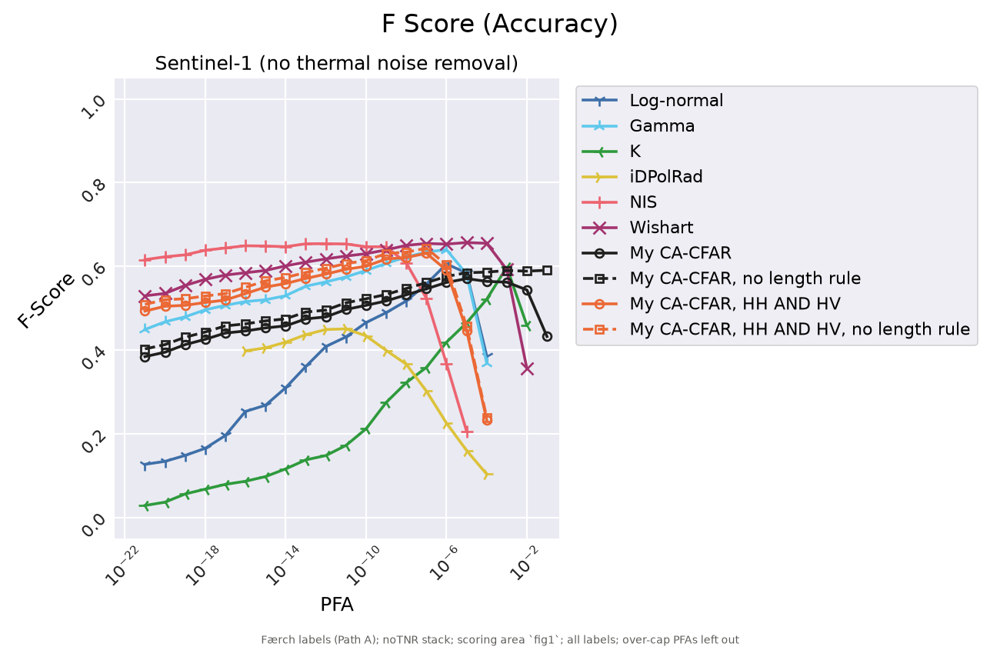
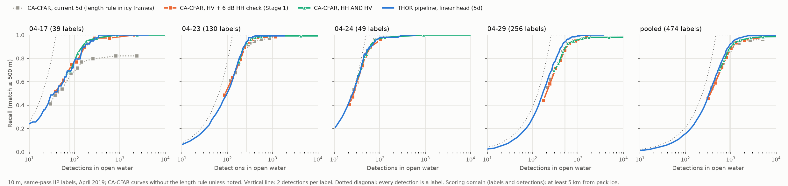

# Does my CA-CFAR behave like a standard gamma CA-CFAR?

Stage 2, Milestone 2c (2026-10-30). My baseline is the Stage 1 CA-CFAR: HV only, a fixed 6 dB HH
co-pol check, ENL measured on the scene, and an ice-strip length rule. Here it is compared
against the six published CFAR detectors of Færch et al. 2023 (their code), on two datasets:

- **Færch scene:** one Sentinel-1 EW GRDM scene, 40 m, 492 optical labels. Scored by F, so
  precision counts. Details: [faerch2023-reproduction.md](faerch2023-reproduction.md).
- **IW frames:** four April 2019 HyP3 RTC frames, multilooked to 40 m, 512 same-pass IIP labels.
  Scored by recall at matched detection counts (precision isn't measurable without AIS).
  Details: [m2b_iw40.md](../benchmarks/m2b_iw40.md).

> **Revision 2026-11-02 (after external review): read this first.** All scores now use one
> evaluation mask for labels and detections: 487 of the 492 Færch labels (5 lie outside the
> scoring area), 474 of the 512 IW labels (38 lie within 5 km of pack ice, where detections
> were already dropped). IW recall is read at a fixed detection budget (2 per label = 948) from
> the real run with the most detections at or below it, never interpolated between PFAs.
> Updated numbers:
>
> | | Færch, best F (no TNR) [95% CI] | Færch ΔF vs gamma [95% CI] | IW pooled recall, real run ≤ 948 |
> |---|---|---|---|
> | Gamma (library) | 0.640 [0.599, 0.675] | | 0.84 (777 det.) |
> | My CA-CFAR, HV + 6 dB check, no length rule | 0.591 | −0.049 [−0.076, −0.024] | 0.79 (673 det.) |
> | **My CA-CFAR, HH AND HV, no length rule** | **0.644** [0.604, 0.679] | **+0.004** [−0.012, +0.018] | **0.86** (832 det.) |
> | Wishart / NIS | 0.657 / 0.654 | +0.017 / +0.014 (both include 0) | 0.46 (932) / none ≤ 948 |
>
> **Not distinguishable with this sample:** the HH AND HV CA-CFAR, gamma, Wishart and NIS on
> the Færch scene (bootstrap intervals, [revision-robustness.md](revision-robustness.md)); on
> IW the 40 m detectors land at different detection counts, so compare the curves. Where the
> two pipelines differ (revision C11b, [revision-ablation.md](revision-ablation.md)): from my
> HH AND HV CA-CFAR, fixing the ENL at 10.7, using the library's circular 68 px ring, and its
> object handling (4-connected, 2-500 px, no merging, no edge buffer) each change F by at most
> ±0.013; all three give 0.643 vs gamma 0.640. Fixing the ENL moves the best PFA one decade, onto
> gamma's. **In an ablation on this one scene, the co-pol check accounts for the gap to gamma
> (6 dB check −0.049, HH AND HV +0.004); window geometry, ENL and object handling don't
> measurably change it, and the remaining difference (numerical vs closed-form threshold) is
> not separated.** "Ties" below means not
> distinguishable with this sample.

## Answer

**Yes, at matched detection counts. On F it lags, and the 6 dB co-pol check is the reason.**
Replacing that check with a second CA-CFAR test on HH (HH AND HV per pixel, both at √PFA, each
band with its own measured ENL) makes it match gamma on both datasets:

| | Færch scene, best F (no TNR) | Færch scene, best F (with TNR) | IW pooled recall @ 1,024 det. | IW large bergs |
|---|---|---|---|---|
| Gamma (paper's code) | 0.636 (P 0.82) | 0.428 | 0.83 | 13 / 14 |
| My CA-CFAR as it is (HV + 6 dB check, no length rule) | 0.587 (P 0.85) | 0.494 | 0.82 | 13 / 14 |
| **My CA-CFAR, HH AND HV, no length rule** | **0.639** (P 0.86) | **0.495** | **0.83** | 13 / 14 |
| Best published (Wishart / NIS / K) | 0.653 / 0.650 | 0.533 (K) | 0.81-0.83* | |

\* Gamma, log-normal and K. NIS can't go below 1,082 detections and Wishart can't go above 932.
TNR = thermal noise removal in SNAP 14. Gaps under ~0.02 F or ~0.03 recall are ties (one
scene; 512 labels).



## Where it behaves differently, and why

| Difference | Effect | Evidence |
|---|---|---|
| **HV only + fixed 6 dB HH check** (vs. HH AND HV CFAR) | Caps recall. The check is a second threshold that doesn't move with the PFA, so the curve goes flat (recall ≤ 0.45, precision 0.85-0.97). On the IW frames the curve stops early: 87 detections on 04-24. | 2a ablation: without the check, 0.609. With HH AND HV: 0.639 and recall 0.51. On IW, 04-24 is now reached: 0.97 at 2 det. per label. |
| **ENL measured on the scene** (vs. taken from the product spec, as gamma and Wishart do) | Robust when the statistics change. With TNR, HV's ENL drops from 11.5 to ~1. Mine follows (1.05), gamma keeps 10.7 and floods. The AND variant keeps this robustness. | TNR: mine 0.49-0.50 vs gamma 0.43, NIS 0.23, Wishart > 20,000 objects |
| **ENL estimator** (1 / median CV² over 500 m cells) | Higher than Table 1 (HV 13.4, HH 12.7 vs 10.7), so my curve sits ~1 decade left of gamma on the PFA axis. Same F level. | Fig. above |
| **Ice-strip length rule** (`max_structure_m` 300 m) | Only removes bergs in the scored areas: −0.01 to −0.02 F, large bergs 82 vs 87 %. It is already off in open water (`length_rule: auto`). | 2a; 2b 04-17 0.67 vs 0.83 at 500 det. |
| **Window sizes** (own 200 / 840 m vs paper 360 / 520 m) | No pooled effect (0.83 vs 0.82). Smaller rings raise the threshold factor at a given PFA, so they move the PFA axis. | 2b |
| **Nominal PFA** | Not a common scale between detectors (31 to 1,087 detections at 1e-9 on 04-29). Compare at matched counts or by F level. | 2b |

## Caveats

- One EW scene with precision, and four IW frames from one month without it. On 04-17
  (46 labels) the AND variant is lower (0.52 vs 0.61 at 2 per label, ~4 labels). Pooled it
  ties.
- At 10 m, Stage 1's resolution, the 6 dB check was added against HV speckle grains, because
  HyP3 HV has an ENL of only 0.3-0.8 there. Stage 1 (`run`, 5d, the viewer) still uses it.
  See the 10 m run below.

## At 10 m (the 5d frames, 2026-11-02)

The same AND variant ran on the four 5d frames at native 10 m (own windows, no length rule,
tag `cacfar-nolength-10m-and`). Measured ENL: HV 0.28-0.79, HH 1.3-2.8. It works at 10 m too.
It is level with or slightly ahead of the 6 dB check, and still behind THOR:

| Pooled, 512 labels | @500 | @1,000 | @2,000 | at 2 det. per label | small / medium / large near 1,024 |
|---|---|---|---|---|---|
| CA-CFAR, HV + 6 dB check, no rule | 0.58 | 0.82 | 0.88 | 0.82 | 53 / 353 / 13 (1,008 det.) |
| **CA-CFAR, HH AND HV, no rule** | (starts at 573) | 0.83 | 0.89 | 0.84 | 57 / 370 / 13 (1,152 det.) |
| CA-CFAR, current 5d (rule in icy frames) | 0.58 | 0.80 | 0.86 | 0.81 | 52 / 346 / 10 |
| THOR linear (5d) | 0.62 | 0.86 | 0.91 | 0.86 | 52 / 372 / 11 |

Per frame at 2 detections per label, AND vs 6 dB: 04-17 0.63 / 0.64, 04-23 0.82 / 0.82,
04-24 0.97 / 0.95, 04-29 0.86 / 0.84. The 40 m drop on 04-17 doesn't appear at 10 m. The size
row compares operating points about 14 % apart in count (the sweep has PFA steps of 2 decades),
so read its +4 small / +17 medium as a tendency, not a measurement. The AND curve floods quickly
past ~2 detections per label (20,770 at 1e-4, 193,521 at 1e-3, pooled), where the 6 dB curve
stays flat: the check was hiding the HV speckle there, and the HH test now does that job only
at the stricter PFAs.



Switching Stage 1 to AND gains about 0.01-0.02 recall at matched counts. The 3 large bergs
over current 5d come from dropping the length rule, not from AND. Against the 5d headline
CFAR (rule in icy frames), THOR's lead would shrink from 0.05 to about 0.02-0.03 (0.86 vs
0.83-0.84) if both changes were made.
- Its F optimum is narrower than the HV-only curve's (4 vs 7 PFAs within 0.03). The old curve
  was wide only because the check held it flat.

## Reproduce

```
python -m iceberg_sar.cli bench-sweep --only cacfar-and --only cacfar-nolength-and          # no TNR
python -m iceberg_sar.cli bench-sweep --tnr --only cacfar-and --only cacfar-nolength-and    # TNR
python -m iceberg_sar.cli bench-score
python -m iceberg_sar.cli bench-iw-sweep --only cacfar-nolength-and
python -m iceberg_sar.cli bench-iw-sweep --only cacfar-nolength-10m-and                     # 10 m, ~48 min
python -m iceberg_sar.cli bench-iw-compare
```

Variants: `benchmark.faerch2023.sweep.cacfar_copol` and `benchmark.iw_sweep.cacfar_variants`
(`copol: and`) in `benchmarks/config.yaml`. Code: `sweep.and_cfars` and the `copol_cfars`
argument of `detections.detect_raster_multi`. Færch labels are private, so scores stay local.
Runtime is ~2.5 min per Færch sweep. IW frames take 2-3 min each, but 04-29 took 65 min:
the loose PFAs produce ~400k objects before the cap stops the sweep.
