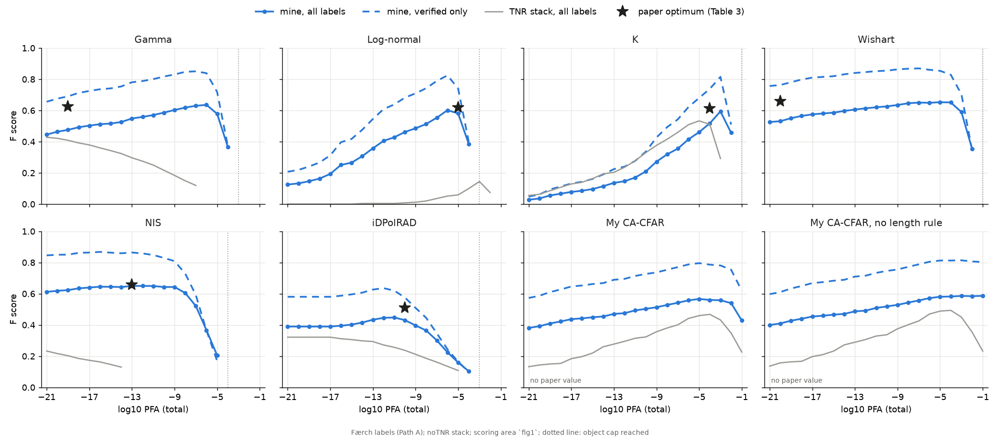

# Which CFAR for the Færch scene, and what thermal noise removal does to the ranking

Stage 2, Milestones 1 and 2a (2026-10-27). One Sentinel-1 EW GRDM scene (2019-07-04),
40 m sigma0, 492 optical iceberg labels from Færch et al. 2023. Six published CFAR detectors (the
paper's code) and my CA-CFAR, each swept over 21 PFAs (1e-21 to 1e-1), scored with the same labels,
matching radii and scoring area. Full setup and tables: [faerch2023-reproduction.md](faerch2023-reproduction.md).

The same scene was processed twice in SNAP 14, once with thermal noise removal (TNR, as the
paper describes) and once without (the stack that reproduces the paper's F).

## Short answer

- **Clean stack (no TNR):** Wishart, NIS and gamma are tied at F 0.64-0.65. NIS is the safest
  pick: its F stays within 0.03 of its best over 10 decades of PFA. My CA-CFAR is 0.05-0.07 behind,
  with the highest precision of all.
- **With TNR the ranking changes.** The detectors that take the ENL from the product spec collapse;
  K and my CA-CFAR, which adapt to the scene's clutter statistics, keep most of their F.
- **The lesson is about where the speckle statistics come from**, not which detector family is
  best: trusting a nominal ENL gives the best F on clean data and fragility on anything else.

## Background in two lines

- **ENL** (equivalent number of looks) measures how smooth the speckle is: high ENL, little
  fluctuation. A CFAR sets its threshold from the ENL, so a wrong ENL means a wrong false-alarm rate.
- **Thermal noise removal** subtracts the sensor's noise floor. SNAP 14 clips the negative results
  to -115 dB instead of 0: 23.7 % of open-water HV pixels end up there, and the HV ENL drops from
  11.5 to ~1.

## Results

Best F over the PFA sweep, all labels (250 m verified / 1789 m interpolated radius):

| Detector | ENL used | Best F, no TNR (PFA) | Best F, TNR (PFA) | Change | TP / FP with TNR |
|---|---|---|---|---|---|
| Wishart | 10.7 (Table 1) | **0.653** (1e-5) | none: > 20,000 objects at every PFA | collapse | – |
| NIS | own estimate | **0.650** (1e-12) | 0.233 (1e-21) | -0.42 | 208 / 1085 |
| Gamma | 10.7 (Table 1) | **0.636** (1e-6) | 0.428 (1e-21) | -0.21 | 208 / 272 |
| Log-normal | fitted locally | 0.602 (1e-6) | 0.145 (1e-3) | -0.46 | 41 / 34 |
| K | 10.7 + local shape | 0.594 (1e-3) | **0.533** (1e-5) | -0.06 | 196 / 47 |
| My CA-CFAR, no length rule | measured (13.4 / 1.05) | 0.587 (1e-1) | **0.494** (1e-4) | -0.09 | 190 / 88 |
| My CA-CFAR, length rule on | measured (13.4 / 1.05) | 0.567 (1e-5) | 0.468 (1e-4) | -0.10 | 175 / 81 |
| iDPolRAD | global fit | 0.448 (1e-11) | 0.322 (1e-21) | -0.13 | 119 / 129 |



How wide the optimum is on the clean stack (PFAs within 0.03 F of the best, of 21):

| NIS | Wishart | My CA-CFAR (no rule) | iDPolRAD | Gamma | Log-normal | K |
|---|---|---|---|---|---|---|
| 11 (1e-19..1e-9) | 7 (1e-10..1e-4) | 7 (1e-7..1e-1) | 4 | 3 | 2 | 1 |

## Clean stack: which detector

- **The top three are a tie.** Wishart 0.653, NIS 0.650, gamma 0.636: 0.017 F is about 5-8
  bergs out of 492, on one scene. The binomial error on recall alone is ~0.02.
- **NIS is the most forgiving.** Its F stays flat over 10 decades of PFA, and it estimates its own
  ENL. K and log-normal need the PFA right to within a decade.
- **My CA-CFAR is precise but finds less**: precision 0.85-0.97 over the whole sweep, recall never
  above 0.45 (gamma: 0.52). The cause is the fixed 6 dB HH co-pol check, a second threshold that
  doesn't move with the PFA. Without it, F rises to 0.609; the rest of the gap to gamma (~0.025)
  is about what HV alone costs against gamma's HH AND HV test.

## With thermal noise removal: what changes

- **Fixed-ENL detectors fail.** Gamma and Wishart keep ENL 10.7 while the water now behaves like
  ENL ~1, so their threshold is far too low and speckle passes everywhere. Wishart doesn't get
  below 20,000 objects at any PFA; gamma's false positives go from 55 to 272.
- **My CA-CFAR adapts.** It measures the ENL from the scene (1.05 here, 13.4 on the clean stack)
  and raises its threshold to match. It still loses 0.09: in dark patches the clipped -115 dB pixels
  pull the background mean towards zero, so false positives rise from 14 to 81 and true positives
  fall from 200 to 175.
- **K holds up best** (-0.06): it fits the clutter's shape locally, so heavier-tailed water
  raises its threshold.
- **NIS is unexplained.** It estimates its own ENL, yet collapses (1,085 false positives). Not
  investigated.

## Caveats

- One scene, one date, one set of labels. Differences under ~0.02 F are ties.
- Gamma, NIS and iDPolRAD peak at 1e-21 on the TNR stack, the end of the sweep. Their TNR optimum
  may lie at even lower PFAs, so their TNR F may be slightly underestimated.
- The TNR damage is specific to SNAP 14's clipping. Another processor that removes the noise
  floor differently might hurt the fixed-ENL detectors less. Which SNAP version the paper used is
  an open question for the authors.
- PFA values are not a common scale between detectors (different ENLs, AND merge vs one channel).
  Compare F levels and curve shapes, not PFAs.

## What this means for my detector

The measured ENL is my CA-CFAR's strength; the fixed 6 dB HH check is its weakness. Replacing
the check with an HH CFAR test at the same per-channel PFA (HH AND HV, like gamma), while keeping
the measured ENL, should land near gamma on clean data and keep the robustness with TNR.
That is a hypothesis to test in Milestone 2c.

## Reproduce

```
python -m iceberg_sar.cli bench-sweep      # reference detectors + my CA-CFAR (noTNR stack)
python -m iceberg_sar.cli bench-score      # tables, figures, docs/faerch2023-reproduction.md
```

The TNR stack's sweep lives in `data/benchmark/faerch2023/sweep/`, scores in
`data/benchmark/faerch2023/score/scores_TNR.csv` (local; the Færch labels are private and not in
the repo). The ablation of my CA-CFAR's rules was a one-off diagnostic
(`score/cacfar_ablation*.csv`), not a command yet.
