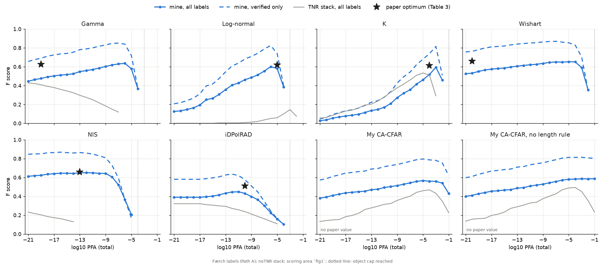
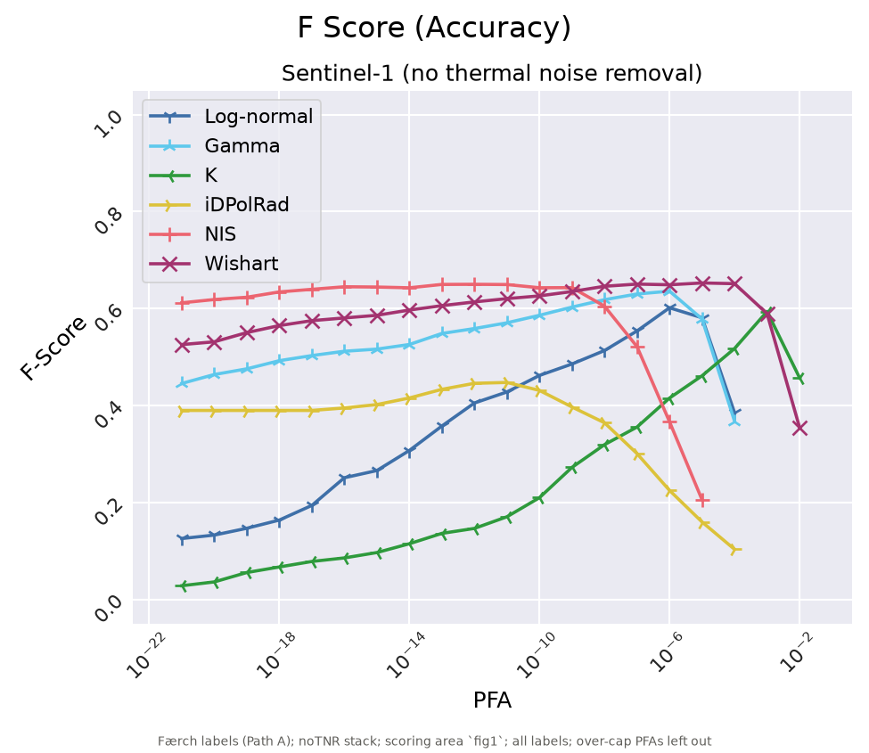

# Færch 2023 reproduction (Stage 2, Milestone 1)

Generated by `python -m iceberg_sar.cli bench-score`. Setup:

- Scene: `S1A_EW_GRDM_1SDH_20190704T102730_20190704T102831_027966_032866_4053`, SNAP 40 m sigma0 (1b), OSM land + 500 m (1c).
- Detectors: the paper's code (`cfar-object-detection`, GPL-3.0, run externally), AND merge for gamma / log-normal / K, windows 360 / 520 m (9 / 13 px), iDPolRAD 3 / 57 px cropped to the library's 41 px, objects 2-500 px.
- Thermal noise removal: **off** (decided 2026-10-26). SNAP 14's noise removal clips negatives to -115 dB and gives HV an ENL of ~1, which breaks the paper's ENL; the run with it is the grey curve and the last table column.
- ENL 10.7 for both bands (Table 1). Measured on this stack (median 2 km open-water box): HH 10.738, HV 11.459.
- PFA: 21 levels, 1e-21 .. 1e-1 total; a detector stops after the first PFA with > 20000 objects in the scene (dotted line).
- Labels: Færch (Path A), 492 bergs (5 outside the scoring area, still counted as the paper counts all 492). Radii 250 m verified / 1789 m interpolated.
- Scoring area: `fig1` (S1 valid area x the S2 and ALOS-2 outlines georeferenced from Fig. 1, a few km accuracy). Detections within 250 m of an unknown SAR object are ignored.
- Matching: greedy one-to-one, closest pair first. Verified-only: verified labels, 250 m;
  detections near interpolated labels that match nothing are ignored.

## F at the optimum PFA (tolerance 0.05)

Paper F is derived from Table 3 (TP, FP, FN). My optimum is the PFA with the highest
all-labels F.

| Detector | Paper PFA | My PFA | Paper TP / FP / FN | Mine TP / FP / FN | Paper F | My F | Diff | Within | Verified-only F (at my PFA / best) | F, AOI `reconstructed` | F with TNR (PFA) |
|---|---|---|---|---|---|---|---|---|---|---|---|
| Gamma | 1e-19 | 1e-6 | 238 / 32 / 254 | 255 / 55 / 237 | 0.625 | 0.636 | +0.011 | yes | 0.839 / 0.851 (1e-7) | 0.631 | 0.428 (1e-21) |
| iDPolRAD | 1e-10 | 1e-11 | 193 / 74 / 299 | 162 / 70 / 330 | 0.509 | 0.448 | -0.061 | **no** | 0.620 / 0.636 (1e-12) | 0.445 | 0.322 (1e-21) |
| K | 1e-4 | 1e-3 | 239 / 49 / 253 | 218 / 24 / 274 | 0.613 | 0.594 | -0.019 | yes | 0.815 / 0.815 (1e-3) | 0.584 | 0.533 (1e-5) |
| Log-normal | 1e-5 | 1e-6 | 231 / 24 / 261 | 225 / 31 / 267 | 0.619 | 0.602 | -0.017 | yes | 0.825 / 0.825 (1e-6) | 0.595 | 0.145 (1e-3) |
| NIS | 1e-13 | 1e-12 | 273 / 65 / 219 | 261 / 50 / 231 | 0.658 | 0.650 | -0.008 | yes | 0.858 / 0.868 (1e-16) | 0.651 | 0.233 (1e-21) |
| Wishart | 1e-20 | 1e-5 | 276 / 70 / 216 | 268 / 61 / 224 | 0.659 | 0.653 | -0.006 | yes | 0.854 / 0.870 (1e-7) | 0.656 | none |

No `benchmarks/faerch2023/reference_fig6.csv`, so the paper's Fig. 6 curves are not overlaid; the star
is Table 3's optimum.

All detectors on one panel, all labels, styled like the paper's Fig. 6 for a
side-by-side read:

## Detected share by size at the optimum (Table 5)

Table 5 uses its own optimum PFA, which differs from Table 3 for Gamma, K, Log-normal.

| Detector | Size | Paper % (PFA) | Mine at that PFA | Mine at my optimum |
|---|---|---|---|---|
| Gamma | small | 6.6 (1e-9) | 1.1 | 9.9 |
| Gamma | medium | 57.7 (1e-9) | 25.1 | 64.6 |
| Gamma | large | 91.9 (1e-9) | 71.3 | 91.2 |
| iDPolRAD | small | 5.0 (1e-10) | 2.2 | 2.2 |
| iDPolRAD | medium | 40.6 (1e-10) | 17.7 | 31.4 |
| iDPolRAD | large | 83.1 (1e-10) | 64.0 | 75.7 |
| K | small | 6.6 (1e-2) | 17.1 | 3.9 |
| K | medium | 58.9 (1e-2) | 70.9 | 50.9 |
| K | large | 91.2 (1e-2) | 93.4 | 89.7 |
| Log-normal | small | 6.6 (1e-2) | over cap | 6.1 |
| Log-normal | medium | 56.0 (1e-2) | over cap | 54.9 |
| Log-normal | large | 89.0 (1e-2) | over cap | 86.8 |
| NIS | small | 11.6 (1e-13) | 5.0 | 7.7 |
| NIS | medium | 70.3 (1e-13) | 55.4 | 69.7 |
| NIS | large | 94.9 (1e-13) | 89.0 | 91.9 |
| Wishart | small | 13.3 (1e-20) | 2.8 | 8.8 |
| Wishart | medium | 69.7 (1e-20) | 38.9 | 72.0 |
| Wishart | large | 95.6 (1e-20) | 77.9 | 92.6 |

## Discussion

**Verdict (2026-10-27).** With the paper's own labels (Path A), five of six detectors reproduce
the paper's best F within 0.05: gamma +0.011, Wishart -0.006, NIS -0.008, log-normal -0.017,
K -0.019. iDPolRAD is 0.061 below. The shapes agree with the paper's sec. 4: "The K detector and
the log-normal detector achieve their maximum accuracy at a very narrow interval of PFA levels,
whereas the gamma, iDPolRAD, NIS, and Wishart generally exhibit higher F score across a wide
range of PFA levels." Fig. 6 is not digitized, so the comparison of shapes is by eye.

**Deviation: no thermal noise removal.** The paper lists thermal noise removal among its SNAP
steps. With SNAP 14 that step breaks the detectors' assumptions (grey curves, last table column:
every detector stays at F 0.53 or below, Wishart produces >20,000 objects even at 1e-21):

| ENL on the 40 m GRDM stack | HH | HV |
|---|---|---|
| Table 1 (product definition) | 10.7 | 10.7 |
| With thermal noise removal, median 2 km open-water box | 9.5 | 0.98 |
| Without, same boxes | 10.74 | 11.45 |
| With, 1 km boxes around gamma's false positives (1e-19) | 0.51 | 0.43 |

SNAP 14 subtracts the noise floor and clips negative values to ~3.7e-12 (-115 dB), not 0: 23.7 % of
HV and 0.75 % of HH open-water pixels sit there. Dark, calm water then fluctuates far more than an
ENL of 10.7 allows, and the false positives cluster in one such patch near the coast (median HH
-35.6 dB). SNAP 14 also ignores `removeThermalNoise=false`, so the run without it drops the node
from the graph (`preprocess.graph_variant`). Without noise removal the measured ENL matches
Table 1, which is what the detectors assume. Which SNAP version the paper used, and what its
noise removal did, is an open question for the authors.

**Optimum PFA.** NIS, K, log-normal and iDPolRAD peak within one decade of the paper's optimum.
Gamma (1e-6 vs 1e-19) and Wishart (1e-5 vs 1e-20) reach the paper's F, TP and FP about 13-15
decades higher: at the paper's PFA they detect fewer objects (gamma 1e-19: TP / FP 156 / 8 vs
238 / 32). These are the two detectors that take the ENL as given (NIS estimates its own; K's
look-up table also uses it, but K matches). A different effective ENL in the paper's gamma and
Wishart runs would shift the PFA axis without changing the F level; not checked. Tables 3 and 5
also disagree on gamma's optimum PFA (1e-19 vs 1e-9) while describing the same detections.

**iDPolRAD (outside tolerance, -0.061).** Same number of false positives as the paper (70 vs 74),
fewer true positives (162 vs 193), mostly medium bergs (31 % vs 41 %). iDPolRAD's threshold
comes from one generalized-gamma fit over the whole image (10,000 random pixels, `cfar_api_notes.md`),
so it depends on what the image contains: our land mask (OSM coastline + 500 m), swath and
noise-floor handling differ from the paper's. Its 57 px training window is cropped to the
library's 41 px, as it must have been in the paper. The flat start of the curve (1e-21 to 1e-17,
identical detections) is the global threshold saturating.

**What else holds.**
- Labels are not the issue: Path A reproduces Table 2 exactly (181 / 175 / 136) and the mean
  verified drift (3954 vs 3953 m).
- Scoring area: the cloud-free Path B area changes F by at most 0.011.
- Verified-only F is 0.81-0.87 at each optimum: most misses are interpolated (1789 m) labels,
  i.e. small bergs whose position is uncertain.
- Size breakdown at my optimum follows Table 5 (large 87-93 %, small 4-10 %), except iDPolRAD.
- GRDH instead of GRDM (gamma 1e-19): more false positives (575 vs 341) and higher recall, so
  the paper's 40 m, ENL 10.7 product is GRDM; Table 1's "GRDH" is a typo.
- Sweep coverage (1e-1 to 1e-21): 117 of 126 (detector, PFA) runs scored; the other 9 are above
  the 20,000-object cap, where precision is below 0.1.

**Open questions for the authors:** SNAP version and whether thermal noise removal was applied;
the ENL passed to gamma and Wishart; the radius for the 15 small `manual` labels (250 m used);
Table 3 vs Table 5 optimum PFAs.

## Files

- per-run scores, noTNR: `data/benchmark/faerch2023/score/scores_noTNR.csv` (local)
- per-run scores, TNR: `data/benchmark/faerch2023/score/scores_TNR.csv` (local)
- runtime per detector and PFA: `data/benchmark/faerch2023/sweep_noTNR/sweep_runtime.csv`
- reference values: `benchmarks/faerch2023/reference.yaml`
