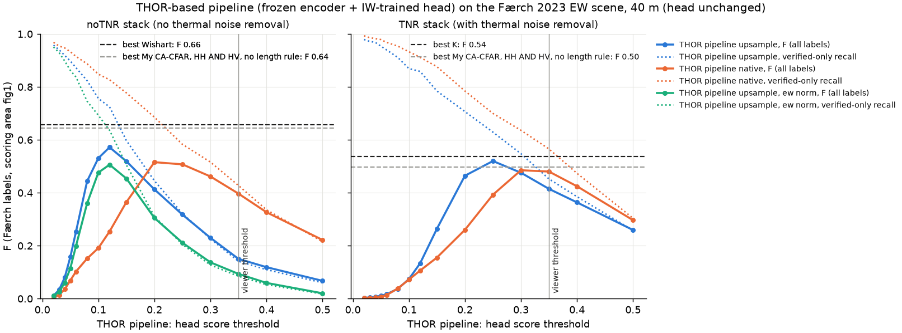

# THOR-based pipeline (frozen encoder + IW-trained head) on the Færch 2023 scene (Sentinel-1 EW, 40 m)

Generated by `bench-thor`; don't edit by hand.

## Setup

- Head: the final linear head (`linear`), trained on 10 m HyP3 IW frames off Newfoundland, April-June. Nothing retrained or tuned on this scene.
- Crops of 5.12 km (128 px), 64 x 64 tokens of 80 m, as in training. `upsample`: bands declared 10 m, THOR resizes the crop to 512 px; `native`: bands declared 40 m, 2 x 2 px patches.
- SNAP sigma0 (no gamma0 conversion). Normalisation: THOR's IW stats (what the head was trained with) unless the run says `ew norm` (THOR's own EW HH/HV stats). Land mask only (no pack-ice mask). Peaks: 3 x 3 token maxima, moved to the brightest HH pixel.
- Scoring as `bench-score`: 487 Færch labels in the scoring area `fig1` (one shared evaluation mask for labels and detections), 250 m verified / 1789 m interpolated, detections near unknown objects ignored. The score threshold is swept the way the CFARs' PFA is.

## Best F per stack and run

| stack | run | threshold | detections | P | R | F | R verified | R small | R medium | R large |
|---|---|---|---|---|---|---|---|---|---|---|
| TNR | upsample | 0.25 | 217 | 0.843 | 0.376 | **0.520** | 0.629 | 0.045 | 0.408 | 0.776 |
| TNR | native | 0.3 | 288 | 0.653 | 0.386 | **0.485** | 0.636 | 0.067 | 0.408 | 0.784 |
| noTNR | upsample | 0.12 | 258 | 0.826 | 0.437 | **0.572** | 0.724 | 0.061 | 0.489 | 0.873 |
| noTNR | native | 0.2 | 316 | 0.655 | 0.425 | **0.516** | 0.686 | 0.061 | 0.443 | 0.888 |
| noTNR | upsample, ew norm | 0.12 | 248 | 0.750 | 0.382 | **0.506** | 0.636 | 0.045 | 0.402 | 0.806 |

## CFAR detectors on the same stacks (`bench-score`, best F over PFA)

| stack | detector | PFA | detections | P | R | F | R verified | R small | R medium | R large |
|---|---|---|---|---|---|---|---|---|---|---|
| TNR | K | 1e-05 | 243 | 0.807 | 0.402 | 0.537 | 0.689 | 0.039 | 0.437 | 0.843 |
| TNR | My CA-CFAR, HH AND HV, no length rule (mine) | 1e-09 | 264 | 0.708 | 0.384 | 0.498 | 0.650 | 0.045 | 0.425 | 0.784 |
| TNR | My CA-CFAR, no length rule (mine) | 1e-04 | 278 | 0.683 | 0.390 | 0.497 | 0.664 | 0.045 | 0.431 | 0.799 |
| TNR | My CA-CFAR (mine) | 1e-04 | 256 | 0.684 | 0.359 | 0.471 | 0.611 | 0.039 | 0.414 | 0.716 |
| TNR | My CA-CFAR, HH AND HV (mine) | 1e-09 | 246 | 0.699 | 0.353 | 0.469 | 0.597 | 0.039 | 0.408 | 0.701 |
| TNR | Gamma | 1e-21 | 480 | 0.433 | 0.427 | 0.430 | 0.724 | 0.056 | 0.489 | 0.843 |
| TNR | iDPolRAD | 1e-16 | 278 | 0.432 | 0.246 | 0.314 | 0.420 | 0.017 | 0.172 | 0.649 |
| TNR | NIS | 1e-21 | 1293 | 0.161 | 0.427 | 0.234 | 0.654 | 0.145 | 0.448 | 0.776 |
| TNR | Log-normal | 1e-03 | 75 | 0.547 | 0.084 | 0.146 | 0.131 | 0.028 | 0.057 | 0.194 |
| noTNR | Wishart | 1e-05 | 329 | 0.815 | 0.550 | 0.657 | 0.908 | 0.089 | 0.724 | 0.940 |
| noTNR | NIS | 1e-12 | 311 | 0.839 | 0.536 | 0.654 | 0.883 | 0.078 | 0.701 | 0.933 |
| noTNR | My CA-CFAR, HH AND HV, no length rule (mine) | 1e-07 | 293 | 0.857 | 0.515 | 0.644 | 0.837 | 0.095 | 0.638 | 0.918 |
| noTNR | Gamma | 1e-06 | 310 | 0.823 | 0.524 | 0.640 | 0.862 | 0.101 | 0.649 | 0.925 |
| noTNR | My CA-CFAR, HH AND HV (mine) | 1e-07 | 286 | 0.853 | 0.501 | 0.631 | 0.813 | 0.089 | 0.638 | 0.873 |
| noTNR | Log-normal | 1e-06 | 256 | 0.879 | 0.462 | 0.606 | 0.781 | 0.061 | 0.552 | 0.881 |
| noTNR | K | 1e-03 | 242 | 0.901 | 0.448 | 0.598 | 0.746 | 0.039 | 0.511 | 0.910 |
| noTNR | My CA-CFAR, no length rule (mine) | 1e-01 | 258 | 0.853 | 0.452 | 0.591 | 0.760 | 0.061 | 0.523 | 0.881 |
| noTNR | My CA-CFAR (mine) | 1e-05 | 214 | 0.935 | 0.411 | 0.571 | 0.696 | 0.034 | 0.477 | 0.828 |
| noTNR | iDPolRAD | 1e-11 | 232 | 0.698 | 0.333 | 0.451 | 0.562 | 0.022 | 0.316 | 0.769 |

## Caveats

- One scene, July 2019, about 58° N; the head never saw EW, 40 m or July.
- The threshold is chosen on this scene (best F), as the CFARs' PFA is in `bench-score`; neither is a held-out operating point.

## Files

- scores per threshold: `data/benchmark/faerch2023/thor/thor_scores.csv` (local)
