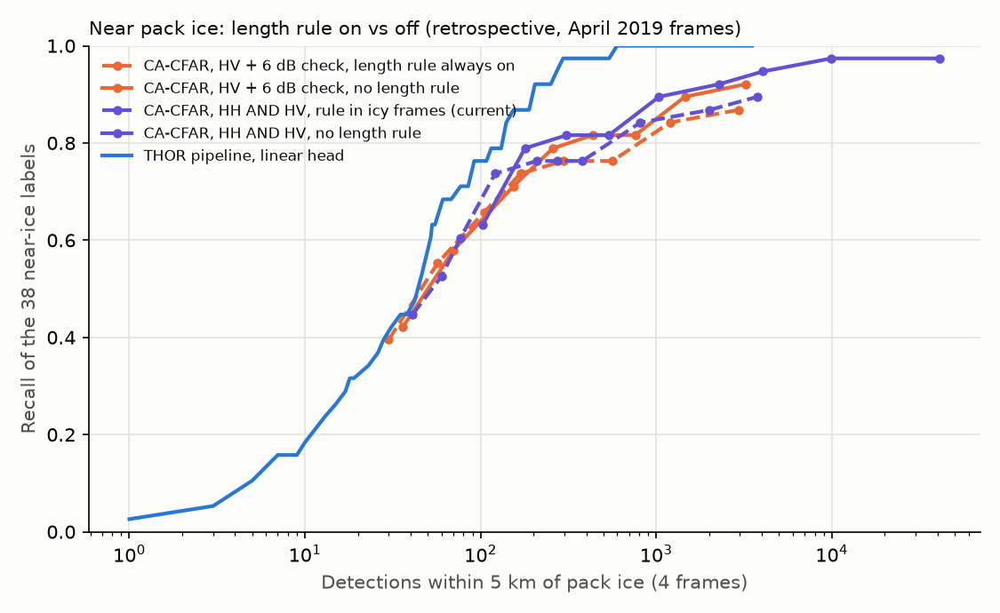

# Near pack ice: does the length rule help? (revision C8)

Generated by `python -m iceberg_sar.cli bench-near-ice`. Labels and detections both restricted to within 5 km of the buffered pack-ice mask: 38 labels (2019-04-29: 11, 2019-04-23: 20, 2019-04-24: 0, 2019-04-17: 7). Retrospective: these frames were looked at when the rule and its 500 km² trigger were set.

## Shared settings, rule on vs off

| Pair | PFA | Rule on: detections / matched | Rule off: detections / matched |
|---|---|---|---|
| HV + 6 dB check | 1e-03 | 2942 / 33 | 3234 / 35 |
| HV + 6 dB check | 1e-04 | 1197 / 32 | 1457 / 34 |
| HV + 6 dB check | 1e-05 | 563 / 29 | 759 / 31 |
| HV + 6 dB check | 1e-06 | 297 / 29 | 435 / 31 |
| HV + 6 dB check | 1e-07 | 169 / 28 | 258 / 30 |
| HV + 6 dB check | 1e-08 | 105 / 25 | 154 / 27 |
| HV + 6 dB check | 1e-10 | 57 / 21 | 70 / 22 |
| HV + 6 dB check | 1e-12 | 30 / 15 | 36 / 16 |
| HH AND HV | 1e-05 | 3771 / 34 | 4039 / 36 |
| HH AND HV | 1e-06 | 2016 / 33 | 2285 / 35 |
| HH AND HV | 1e-08 | 812 / 32 | 1038 / 34 |
| HH AND HV | 1e-10 | 380 / 29 | 538 / 31 |
| HH AND HV | 1e-12 | 209 / 29 | 309 / 31 |
| HH AND HV | 1e-14 | 121 / 28 | 179 / 30 |
| HH AND HV | 1e-16 | 77 / 23 | 103 / 24 |

HH AND HV: the rule is on only in 04-17 and 04-23 (>= 500 km² of pack ice), so on 04-29 both columns are the same run. Unmatched detections in the strip are mostly ice clutter, but not all: an unlabelled berg or ship counts there too.

Read the figure, not the rows: at a shared PFA the rule always has fewer detections, so the question is recall at the same number of detections in the strip.
