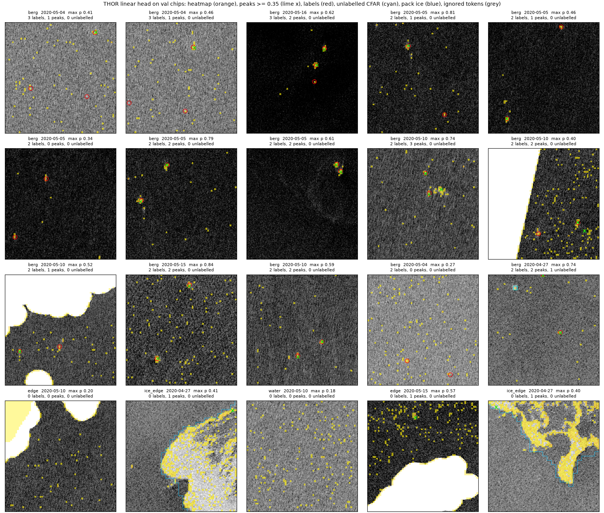
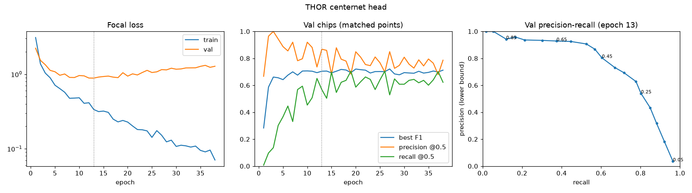
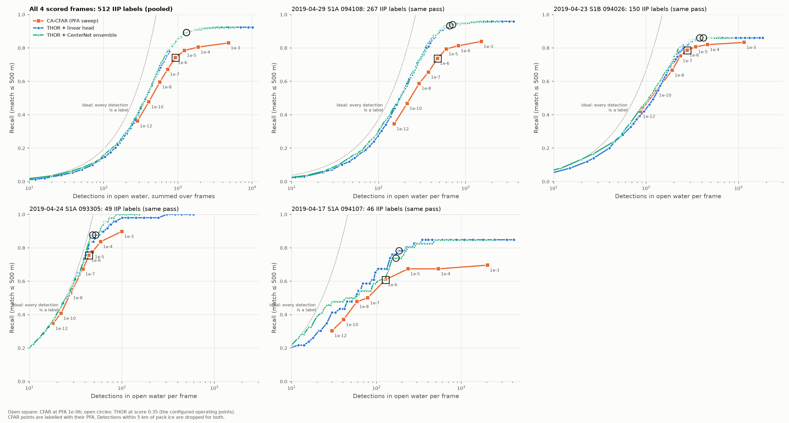

# THOR vs. CFAR (Milestone 5)

Frozen THOR encoder (FM4CS, Apache 2.0) + a small trained head, compared with the CA-CFAR
on the same HH/HV scenes and IIP labels. Reference: Forgaard et al., IGARSS 2026.

## 5a: Smoke test (frozen encoder, no training)

`python -m iceberg_sar.cli thor-smoke [PRODUCT_DIR] [--row R --col C]` embeds one 512×512
crop and writes `data/outputs/thor/smoke_<scene>_r<row>_c<col>.png` + `.json`.

### What THOR expects
- **Bands:** THOR has native `IW_HH` / `IW_HV` patch embeddings (its own band group), so
  HH/HV go in as themselves. No VV/VH slot swap and no domain-shift caveat for that.
- **Radiometry:** pretrained on Sentinel-1 GRD **sigma0**, thermal-noise corrected,
  Range-Doppler geocoded (THOR paper, appendix). HyP3 RTC is gamma0, so we convert with
  sigma0 = gamma0 · cos(incidence) from the HyP3 incidence map.
- **Scale and normalization:** dB, standardized with THOR's 10 m IW stats
  (HH −13.95 ± 6.80 dB, HV −22.46 ± 6.91 dB). Normalization is the caller's job, not the
  backbone's. NaN (land, nodata) → 0 after normalization, i.e. the band mean.
- **Geometry:** `ground_cover` = crop size in metres (512 px × 10 m = 5120 m). At patch 8
  THOR Tiny gives 64×64 tokens × 192 features per block, 12 blocks.
- **Windows:** THOR wraps kernels in `torch.compile`, which needs Triton (not available on
  Windows). `load_encoder` turns dynamo off when Triton is missing; results are identical,
  just un-fused. One 512² crop on the local GPU takes well under a second after model load.

### Result on 2025-05-08 (S1A, 10 m)

| Crop | CFAR bergs | Berg-token distance to water mean (× water median) | Bergs more anomalous than water tokens |
|---|---|---|---|
| Ice edge (rows 782, cols 8439) | 3 | 2.75 | 100% |
| Open water (rows 8554, cols 7072) | 4 | 2.84 | 100% |

(Block 5, HH+HV.) The figure's last panel maps each token's distance from the open-water mean:
- **Open water:** the 4 CFAR bergs are the 4 brightest tokens. A dozen other tokens are
  also bright; they could be small bergs below the CFAR threshold or speckle. A trained head
  has to sort those out.
- **Ice edge:** ice strips form a distinct class in both the PCA and the distance map.
- **PCA RGB is a weak test for bergs.** Water fills >95% of tokens, so the top 3 components
  model speckle (≈12% variance each) and 3–4 berg tokens never get a component of their own.
  The distance map is the more honest view.

### Sweep (same two crops)
- **Block:** mid blocks separate bergs best (block 3: 2.9×, block 5: 2.8×, block 11: 1.8–2.2×).
  Deeper blocks trade local detail for context. Default for the smoke test: block 5. Heads in
  5c will see several blocks (the paper's detector uses blocks 2, 5, 8, 11).
- **HV floor:** clipping HV at −40, −32 or −28 dB changes little. About half of the open-water HV
  pixels are below −40 dB (the HyP3 noise floor is removed), so HV is mostly noise at sea.
- **HH only:** bergs separate somewhat more (3.2–4.3× at block 3). HV stays in, since the
  paper and the CFAR use it and it is what separates pack ice from bergs.

### Things to carry into 5b/5c
- The swath edge lights up in the distance map (NaN filled with the band mean makes a hard
  edge). Drop or down-weight crops with nodata, or mask those tokens out of the loss.
- `seaice_mask` includes a 1 km buffer, so "ice tokens" are mostly water near ice. Use the
  unbuffered ice cores if ice tokens need their own statistics.

**Verdict:** pass. Bergs and ice strips are distinct from open water in the frozen
features. Go ahead with 5b.

## 5b: Training data

`thor-scenes` → `thor-order` → `thor-download` → `preprocess` + `detect` per scene →
`thor-chips`. Output in `data/thor/chips/` (`summary.csv`, `contact_sheet.png`, one folder per
scene with `.npz` chips, `labels.csv`, `index.csv`, `scene.json`).

### Scenes
20 IW HH+HV frames with same-pass IIP Sentinel-1 analyst labels, HyP3 RTC **sigma0** at 10 m
(1,200 credits). Six top-ranked frames were rejected by HyP3 (no DEM over open ocean) and
replaced by the next-ranked ones.

- **Holdout:** 2019-03-25 to 2019-05-06, i.e. April plus a week each side. The frames richest in
  labels (2019-05-04/05/06) came 5-7 days after the 04-29 test scene and would show the same
  bergs, which drift only 10-20 km/day.
- **Split by date:** val = Feb-Mar 2019 (3 frames), at least 8 weeks from any training frame.
  Train = 17 frames, May-Jun 2019 and Apr-May 2020.

### Labels
- **IIP positions are truncated to 0.1 arc-minute.** Moving them to the cell centre halves the
  label error (median 135 m → 67 m). Then each label snaps to the brightest HH peak within 200 m
  if it is ≥ 6 dB above its surroundings: 99% of training labels snap.
- **Labels the model can't see are not targets.** 75 of 515 training labels (15%) fall on
  masked pixels: 82 of the 110 such labels overall are outside the AOI (the land mask exists
  only inside it), 28 are within the 500 m land buffer of islands and islets, where bergs
  often ground. They are kept as `masked_rc` but never rendered as targets.
- **Unlabelled CFAR detections** (no label within 300 m) are stored per chip so the loss can
  ignore them instead of treating them as water: 267 in train, 449 in val.

| Split | Frames | Labels | On masked pixels | Visible, in chips | Crops (berg / water / edge / ice edge) |
|---|---|---|---|---|---|
| train | 17 | 515 | 75 | 432 | 702 (398 / 198 / 99 / 7) |
| val | 3 | 114 | 35 | 78 | 154 (76 / 38 / 20 / 20) |

### Masks in the chips
- **Validity comes from a separate sea mask** (`<scene>_sea.tif`: 1 = sea incl. pack ice,
  0 = land + 500 m buffer, outside the AOI, nodata), written by `preprocess` and backfilled for
  older scenes. The masked bands blank land and pack ice alike. A first version un-masked
  "anything inside the ice mask" to show the model the ice, and near the coast that let land
  through (5% of one ice-edge chip was land, 11% land buffer). Fixed; chips re-cut.
- **The chip `ice` layer is pack ice without the CFAR's 1 km buffer** (`<scene>_seaice_core.tif`,
  the buffered mask eroded by the same disk). The buffer keeps floes away from the CFAR; THOR
  sees the real pixels and should learn where the ice actually is. Ice-edge chips are sampled
  on this core, so they contain real ice (median 12% of the chip), not just buffer water.

### Caveats
- **Ice-detector false alarms at the swath edge (fixed for calm days).** On calm days the
  open-water reference drops to about -36 to -37 dB (HyP3 removes the HV noise floor), and
  water within ~4 km of the swath edge (about 1-1.5 dB brighter) passed the +6 dB rule. 12 of
  the first 18 training "ice-edge" chips held no visible ice. Fix: `seaice.min_db: -30`, an
  absolute floor on top of the relative rule. Real ice cells sit at -27.6 dB (p1) and above;
  the false cells at -30 to -31 dB. Checked on all 35 processed scenes: only 2 masks change
  (2019-05-17: 98 -> 0 km2, 2020-05-16: 83 -> 8 km2, buffered), both training scenes; the
  viewer and validation scenes are unaffected. Training ice-edge chips: 18 -> 7, six of them
  real pack ice (2020-04-27); one small coastal patch on 2019-05-11 still looks like water.
- **Not fixed: brighter swath-edge water on the Sep/Oct 2026 scenes.** 2026-10-01 still shows
  ~70 km2 of "ice" (water at about -29 dB, 62% of it within 4 km of the swath edge). An
  incidence-angle-dependent water reference does not explain it (water HV is flat from 30 to
  46 deg) and shifts real ice by -6 to +8%. Needs a local water reference or swath-edge
  handling. These scenes are not used in the viewer, validation or THOR training.
- **Not fixed: ice-dominated scenes** (Feb-Mar 2019). When ice covers most of the scene the
  open-water reference is itself ice, and only part of the pack is masked.
- **The pack-ice mask fails in early-season scenes.** It defines open water from the darkest
  quarter of the scene; when ice covers most of it (Feb-Mar 2019) the reference is ice and the
  pack goes unmasked. The CFAR then fires on floes: 326 of 329 detections on 2019-03-06 have no
  label. This affects val more than train, and matters for the 5d comparison too.
- One berg can appear in two adjacent frames of the same pass (both in train); that is the
  same image twice, not leakage across splits.

## 5c: Heads on frozen features

```
python -m iceberg_sar.cli thor-features                      # cache encoder features (once)
python -m iceberg_sar.cli thor-train --head linear           # folds a, b, then the final model
python -m iceberg_sar.cli thor-train --head centernet
python -m iceberg_sar.cli thor-overlays --head linear --fold a
python -m iceberg_sar.cli thor-detect <product_dir> --head linear [--model fold_a]
```

Everything lands in `data/models/thor/<head>/{fold_a,fold_b,final}/` (gitignored): `head.pt`,
`history.csv`, `curves.png`, `summary.json`, and for folds `val_overlays.png`, `val_pr.csv`.

### Setup
- **Feature cache:** THOR Tiny blocks 2, 5, 8, 11 (the paper's taps) concatenated, float16:
  768 × 64 × 64 per chip, 5.4 GB for 856 chips, 10 minutes on the laptop RTX 3070.
- **Targets:** a Gaussian per visible label on the 64 × 64 token grid (σ = 60 m, peak token = 1).
  Ignored in the loss: tokens with < 50% sea, and the 3 × 3 tokens around unlabelled CFAR
  detections and labels on masked pixels.
- **Heads:** features standardized per channel (train stats, part of the checkpoint), then
  (1) a 1 × 1 conv (769 parameters) or (2) CenterNet-style 1 × 1 → 3 × 3 → 1 × 1 with GELU and
  dropout, ending in a sigmoid. Penalty-reduced focal loss (α = 2, β = 4), AdamW, cosine
  learning-rate schedule.
- **Val score:** 3 × 3 max-pool peaks on the token grid, matched one-to-one to the labels
  within 200 m. Peaks on ignored tokens count neither way. Precision is a lower bound: a real berg
  that neither the analysts nor the CFAR flagged counts as a false alarm.

### The val split had to change
The 5b val split (Feb-Mar 2019) turned out to measure something else. Those chips are mostly
**close pack ice**: bright, textured, with leads, and bergs sitting inside the ice. The ice
detector misses that pack (the open-water reference is itself ice), so the chips look like "sea"
to the masks. Training is all open water. On that split both heads reached F1 0.2-0.3, and the
overlays showed why: the model had never seen this background.

Replaced by two **year folds** (`thor.train.folds`):

| Fold | Train | Val |
|---|---|---|
| a | 2019 May-Jun (7 frames, 274 chips) | 2020 Apr-May (10 frames, 428 chips, 278 labels) |
| b | 2020 Apr-May (428 chips) | 2019 May-Jun (274 chips, 213 labels) |

A year apart, so no berg is in both. The Feb-Mar 2019 chips are never trained on and are scored
as a separate **pack-ice** set. The April 2019 test holdout is not used anywhere in 5c.

### Fold results

| Head | Parameters | Fold | Best epoch | Best F1 (threshold) | Precision | Recall | Pack-ice F1 |
|---|---|---|---|---|---|---|---|
| Linear | 769 | a | 159 | **0.72** (0.35) | 0.70 | 0.74 | 0.23 |
| Linear | 769 | b | 151 | **0.83** (0.30) | 0.83 | 0.83 | 0.35 |
| CenterNet, hidden 32 | 34 k | a | 13 | 0.70 (0.35) | 0.69 | 0.72 | 0.18 |
| CenterNet, hidden 32 | 34 k | b | 11 | 0.81 (0.30) | 0.83 | 0.80 | 0.21 |
| CenterNet, hidden 64 / 256 (one-off sweep) | 0.09-0.8 M | a | 6-13 | 0.66-0.69 | | | |



- **The frozen features are close to linearly separable for open-water bergs.** A 769-parameter
  linear map matches or beats every CenterNet variant on both folds. Every CenterNet overfits
  within 15 epochs (train loss keeps falling, val loss turns up), even at 34 k parameters. With
  ~150 berg chips per year, extra head capacity mostly memorizes. CenterNet does hold higher
  precision at strict thresholds (≈ 0.93 at recall 0.45 vs ≈ 0.85 for linear, fold a).
- **More training data helps more than a bigger head:** fold b (428 train chips) reaches F1 0.83,
  fold a (274) 0.72. The val sets differ too, so this is a hint, not a controlled comparison.
- **Bergs inside pack ice stay out of reach** (F1 0.2-0.35). The pack-ice edge also scores 0.1-0.4
  on open-water chips. Keep the CFAR's ice mask for THOR detections.
- **Misses are mostly rough-sea chips** (2020-05-04) where several labels show no visible target
  in HH at all.



### Final models: training without a val set
The 5d models should learn from both years (702 chips), and then no val set is left. That is
fine because of what each data set is for:

- **Val chooses; test measures.** The folds' val sets chose the head, its size, the regularization
  and how long to train. Those choices are now fixed in `config.yaml`. The number we report is
  measured in 5d on April 2019, which nothing in 5c has touched. Refitting on all data with a
  recipe fixed beforehand is standard practice and does not bias that test.
- **The real risk is the training length.** "Stop at epoch N" was learned on 274 or 428 chips;
  with 702, one epoch is more update steps, and nothing stops training if it starts to overfit.
  That risk differs a lot between the two heads, so they get different final models
  (`thor.train.final`):

| Head | Final model | Why |
|---|---|---|
| Linear | **Refit** on all 702 chips for 150 epochs | Best epochs 159 / 151 on the folds, and val loss is flat from ~100 to 180 (curves above). The cosine schedule runs over the 150 epochs, so the learning rate is ~0 at the end and the result doesn't hinge on the exact count. |
| CenterNet | **Ensemble** of the fold a and b models: mean probability | It peaks at epoch 11-13 and overfits after, so a fixed count that is slightly off would hurt, unseen. Each fold model was early-stopped on its own val year, and together they have seen all 702 chips. Averaging two models usually helps a little too. |

**What can't be measured any more:** a val score for the final models. Each ensemble member has
seen the other's val year, and the refit has seen both. The only held-out check left in 5c is
the pack-ice set, out of domain but never trained on. At threshold 0.35 for every model:

| Model | Pack-ice detections | Precision | Recall | F1 |
|---|---|---|---|---|
| Linear, fold a / fold b | 60 / 31 | 0.28 / 0.55 | 0.20 / 0.20 | 0.23 / 0.29 |
| **Linear final (refit)** | 32 | 0.53 | 0.20 | 0.29 |
| CenterNet, fold a / fold b | 101 / 18 | 0.17 / 0.50 | 0.20 / 0.11 | 0.18 / 0.18 |
| **CenterNet final (ensemble)** | 38 | 0.45 | 0.20 | 0.28 |

The refit lands at its better fold's level and the ensemble beats both members: no sign that
either final model went wrong. It is a sanity check, not a score.

**Rules for 5d, so the test stays honest:**
- Run the final models (`thor-detect --head linear|centernet`, default `--model final`) once on
  the April 2019 scenes. No tuning of anything on those scenes.
- No threshold needs choosing: 5d compares recall at matched detection counts and sweeps the score.
  For the viewer, use the folds' best-F1 threshold (0.30-0.35).
- If something needs changing after 5d, change it on the folds, re-run `thor-train`, and say in
  the write-up that the test was looked at.

### Full-scene inference
`thor-detect` slides 512 px windows with 128 px overlap over the scene. Each scene token comes
from the window whose centre is nearest, so border bergs are counted once. Peaks are 3 × 3 local
maxima ≥ `score_min` (0.1). Each peak moves to the brightest HH pixel in its token, then has to
pass the CFAR's own masked HV raster (land + buffer, pack ice + buffer, AOI). Output (`<tag>` =
`thor-<head>` for the final model, `thor-<head>-fold_a` etc. otherwise):
`<scene>_<tag>_detections.geojson` with the CFAR schema plus `detector`, `model`, `score`,
`token_row/col`, and a token-resolution heatmap GeoTIFF. Blob attributes (area, extent,
contrast) come from pixels ≥ 4 dB above the window median, connected to the peak.

First scene, 2020-05-05, with the **fold a** linear model (2020 is its val year; 50 visible
labels), 8.5 min:

| Detector | Detections | Labels matched (≤ 200 m) |
|---|---|---|
| CA-CFAR (HV) | 34 | 22 (0.44) |
| THOR linear, score ≥ 0.35 | 47 | 30 (0.60) |
| THOR linear, score ≥ 0.2 | 333 | 43 (0.86) |

Counts can differ by a few between runs (GPU floating point); the matches did not. A first sign, not the 5d result. Labels and THOR peaks are both snapped to HH maxima (median
offset 10 m), while the CFAR reports HV blob centroids. The 200 m radius makes that mostly
irrelevant, but 5d should check the recall-vs-radius curve.

### Carry into 5d
- Linear final is the main THOR curve, CenterNet ensemble the second.
- `score_min: 0.1` writes ~4,000 peaks per scene, enough room for the threshold sweep.
- Bergs in pack ice: neither detector handles them; report them separately.
- The CFAR-mask filter on THOR peaks was a no-op on 2020-05-05 (no pack ice in that scene).
  Check `outside_cfar_mask` in the summary on a scene with ice before trusting it.

## 5d: Head-to-head on the held-out April 2019 scenes

```
python -m iceberg_sar.cli thor-detect <2019-04-15> <2019-04-29> --head linear      # final models,
python -m iceberg_sar.cli thor-detect <2019-04-15> <2019-04-29> --head centernet   # once each
python -m iceberg_sar.cli thor-compare --sweep    # CFAR PFA sweep, tables, figure
```

Tables go to `data/outputs/thor/5d/` (`sweep.csv`, `breakdown.csv`, `radius.csv`,
`detections_by_incidence.csv`, `summary.json`), the figure to `docs/img/thor_vs_cfar_recall.png`.

### Setup: everything identical except the detector
- **Masks:** THOR peaks must fall on the CFAR's masked HV raster (land + 500 m, pack ice + 1 km,
  AOI). Both detectors then lose detections within 5 km of pack ice (the open-water filter of
  `validate-points`).
- **Truth and matching:** `pointval.load_truth` (IIP positions at cell centres), kept where the
  SAR is valid, matched one-to-one (`matching.match_points`) within 500 m
  (`validation.max_dist_m`).
- **Recall at a matched number of detections:** precision can't be measured without AIS, so each
  operating point is (detections per scene, labels matched). The CFAR is swept over PFA 1e-3 to
  1e-12 (`thor.compare.cfar_pfas`). THOR is swept over its score: every peak ≥ 0.1 was saved,
  so the threshold is applied afterwards.
- **Nothing was tuned on these scenes.** The models were fixed in 5c. The PFA list, bins and
  radii were in `config.yaml` before the first run.

**Faster CFAR as a side effect.** The sweep runs all PFAs in one pass
(`detections.detect_raster_multi`), because the ring background, grown structures and co-pol
background don't depend on the threshold. Profiling the first attempt showed that
`component_table`'s per-target statistics (`ndimage.sum_labels`, `maximum`, `center_of_mass`)
scanned the whole 40 M px block on every call. They now reduce over the labelled pixels only
(`_LabelStats`). The output is identical (checked against the old code on a synthetic scene, and
by a test that compares one-pass and separate runs). Both April scenes at all 8 PFAs now take
13 minutes. Before, a single PFA on one scene took over 20 minutes.

### Test scenes
| Frame | Truth | Labels compared | Pack ice in frame | Scored |
|---|---|---|---|---|
| **2019-04-29 S1A 094108** | IIP satellite analysts, same pass | **267** | some | yes |
| **2019-04-23 S1B 094026** | same pass | **150** | 2,481 km² | yes (added) |
| **2019-04-24 S1A 093305** | same pass | **49** | none | yes (added) |
| **2019-04-17 S1A 094107** | same pass | **46** | 3,293 km² | yes (added) |
| 2019-04-15 S1A | IIP ship and aircraft sightings, 5.6 h after the pass | 25 | yes | no |

**Three frames were added after the first 5d run**, to test whether the 04-29 result holds up.
They come from the April holdout window: 23 frames there have same-pass analyst labels
(`data/thor/test_candidates.csv`), and none was trained on. HyP3 rejected the richest ones (the
second 04-29 frame with 233 labels, 04-23 frame 094001, 04-17 frame 094042) for "no DEM coverage",
because they are mostly open ocean. The three above are the next ones it accepted. They were
processed exactly like 04-29 (HyP3 RTC gamma0 10 m, `preprocess`, `detect`, `thor-detect` with
the final models). Nothing was changed in the detectors or the comparison rules. The one code
change after the first run was a fairness fix: THOR's matched-count point now takes exactly the
top-N peaks, where a score threshold had kept a few extra tied peaks (476 → 479 on 04-29).

The frames are not fully independent: they are 1-12 days apart, so some bergs appear on more
than one, at different positions. Each is still a separate image with its own sea state and ice.

**2019-04-15 can't be scored.** It has no same-pass labels, and the later sightings need a drift
correction. One offset was estimated from the pooled detections of both detectors, to be applied
to both. The best offset (2.2 km E, 5.1 km N) lines up only 3 sightings, below the 5 that
`pointval` requires, so it isn't used. Without it the sightings sit kilometres from where the
bergs were imaged. The scene is still useful for the pack-ice question below.

### Result: all four frames


Recall at the same number of open-water detections per frame (the CFAR's count at PFA 1e-6):

| Frame | Labels | Detections | CFAR | THOR linear | THOR CenterNet |
|---|---|---|---|---|---|
| 2019-04-29 | 267 | 476 | 0.74 | **0.89** | **0.89** |
| 2019-04-23 | 150 | 278 | 0.79 | 0.82 | 0.83 |
| 2019-04-24 | 49 | 44 | 0.76 | 0.82 | 0.84 |
| 2019-04-17 | 46 | 128 | 0.61 | 0.67 | 0.61 |
| **Pooled** | **512** | **926** | **0.74** | **0.84** | **0.84** |

- **THOR is ahead on every frame (CenterNet ties on 04-17), and by 10 points pooled.** The gap
  differs by frame: +15 on 04-29, 0 to +8 on the others. 04-29 alone overstated it.
- **Pooled, THOR matches the CFAR's recall (0.74) with about 670 detections instead of 926**
  (~28% fewer). The CFAR's best (0.83 at PFA 1e-3, 4,798 detections) takes THOR about 900, ~5×
  fewer. THOR tops out at 0.92.
- **04-17 is low for both** because pack ice is close: 7 of its 46 labels are within 5 km of the
  ice, where both detectors are filtered out, so its ceiling is 0.85. On the CFAR side, loosening
  from 1e-5 to 1e-3 adds 1,800 detections and 1 label.
- **Overlap at the matched count, pooled (linear):** 356 labels found by both, **75 by THOR
  only**, 24 by the CFAR only, 57 by neither. Of the 57, 38 are within 5 km of pack ice.

### 2019-04-29 in detail
The first and largest frame; numbers at its matched count (476 detections each).

| Operating point | Detections (open water) | Labels matched | Recall |
|---|---|---|---|
| CFAR, PFA 1e-6 (configured) | 476 | 197 | 0.74 |
| THOR linear, same count (top 476, score ≥ 0.46) | 476 | 237 | **0.89** |
| THOR CenterNet, same count (top 476, score ≥ 0.49) | 476 | 237 | 0.89 |
| CFAR, PFA 1e-3 (loosest) | 1,513 | 224 | 0.84 |
| THOR linear, score ≥ 0.35 (viewer threshold) | 653 | 249 | 0.93 |
| THOR linear, score ≥ 0.14 | 1,987 | 256 | 0.96 |

(The CFAR's 0.74 is the open-water figure from `validation-findings.md`. Its headline 78% counts
detections near pack ice too.)

- **THOR finds more labelled bergs at every detection count.** It matches the CFAR's recall with
  about 345 detections instead of 476 (~30% fewer), and the CFAR's best recall (0.84 at 1,513
  detections) with about 445 (~3.4× fewer). THOR's top ~100 peaks lie almost on the "ideal" line:
  nearly every one is a labelled berg.
- **Linear and CenterNet are indistinguishable** here, as on the folds. The 769-parameter linear
  head is the one to keep.
- **The CFAR saturates.** Loosening the PFA from 1e-5 to 1e-3 adds 915 detections but only 12
  labels. THOR keeps climbing to 0.96. Of the 11 labels it never finds, all lie within 5 km of
  pack ice, where both detectors' detections are filtered out.

**Overlap at the matched count (476 each, linear):** 186 labels found by both, **51 by THOR
only**, 11 by the CFAR only, 19 by neither.
- The CFAR-only labels are not invisible to THOR. Each has a THOR peak within ~130 m, scoring
  just under the matched threshold (0.15-0.43, checked before the top-N fix).
- Of the 19 found by neither, 11 are within 5 km of pack ice (filtered for both); 8 are small or
  medium bergs in open water.

### Breakdown (pooled, matched count, 926 detections)
| Labels | n | CFAR | THOR linear | THOR CenterNet |
|---|---|---|---|---|
| Small 15-60 m | 73 | 0.71 | 0.71 | 0.75 |
| Medium 61-120 m | 425 | 0.76 | 0.87 | 0.86 |
| **Large > 120 m** | 14 | **0.29 (4)** | **0.79 (11)** | **0.86 (12)** |
| < 5 km from pack ice | 38 | 0 | 0 | 0 |
| 5-20 km from pack ice | 150 | 0.81 | 0.90 | 0.89 |
| > 20 km from pack ice | 275 | 0.80 | 0.93 | 0.94 |
| No pack ice in frame (04-24) | 49 | 0.76 | 0.82 | 0.84 |
| Incidence 35-40° | 112 | 0.79 | 0.88 | 0.87 |
| Incidence 40-47° | 398 | 0.73 | 0.83 | 0.83 |

- **Large bergs: the CFAR sees them and then throws them away.** On 04-29 all four are 30+ dB
  above the sea in HV, so the CFAR threshold fires at any PFA. But their grown blobs measure
  340-470 m, above `detections.max_structure_m` (300 m), the rule that rejects sea-ice strips.
  THOR has no such rule. Pooled, THOR finds 11-12 of 14 large bergs, the CFAR 4. The cause was
  checked on 04-29 only. A better strip test (shape, not just length) could fix the CFAR; it has
  to be tuned off the test frames.
- **Medium bergs carry the result:** 425 of 512 labels, recall 0.76 → 0.87.
- **Small bergs: no gain for the linear head** (0.71 both; CenterNet 0.75). They are near the
  ~20 m true resolution, and a THOR token (patch 8) is 80 m. That is the case for a 4 × 4 run.
- **Incidence angle:** THOR gains about +10 points in both bins (35-40° and 40-47°). Only 2 labels
  are below 35°, so near range is still untested.
- **The matching radius doesn't drive the gap.** Pooled recall at 100 / 200 / 300 / 500 m: CFAR
  0.65 / 0.74 / 0.74 / 0.74, THOR linear 0.72 / 0.84 / 0.84 / 0.84. THOR peaks are snapped to HH
  maxima like the labels, the CFAR reports HV blob centroids, which explains part of the gap at
  100 m. From 200 m on, both curves are flat.

### Where THOR doesn't beat the CFAR
- **Pack ice, on its own.** On 2019-04-15 (pack ice in the scene) 47% of the linear head's peaks
  (5,368 of 11,431) and 59% of CenterNet's (15,810 of 26,817) fall in the CFAR's masked area
  and are dropped; on the added icy frames 34-82% (04-17, 04-23, both heads). On 04-29, with little ice, it
  is 3% (118 of 4,001), and on ice-free 04-24 it is 0. THOR alone fires on
  pack ice and ice strips (5c pack-ice set: F1 0.2-0.35). It depends on the HV pack-ice mask
  of the CFAR pipeline.
- **Bergs in or near pack ice:** neither detector is scored there.
- **Compute:** the CFAR runs on CPU (the full 8-PFA sweep takes ~6 min per scene). THOR needs a
  GPU: 8-15 min per scene on the laptop RTX 3070.

### Caveats
- **Four frames, 512 labels, all from April 2019.** The pooled gap (0.74 vs 0.84) is about
  five times the sampling noise (±0.02 for a binomial at n = 512), and THOR leads on every frame.
  But it is one month of one year, the frames share some bergs, and near range is untested. The
  per-frame gaps (0 to +15) show how much one frame can vary; 04-29 alone overstated it.
- **THOR learned what IIP analysts label; the CFAR did not.** The head was trained on IIP
  satellite labels from other dates in 2019 and 2020. Agreeing with the analysts on these bergs is
  the aim, but part of the gap may be agreement with their labelling style, not only better
  detection.
- **Unlabelled detections count against neither detector.** At the matched count (926), the CFAR
  has 546 and THOR 495 detections without a label: bergs the analysts skipped, ships or clutter.
  Without AIS the two can't be compared on precision.

### Clutter check on spring 2025 (no labels)
Open-water detections per scene, CFAR (PFA 1e-6) vs. THOR linear:

| Scene | CFAR | THOR ≥ 0.35 | THOR ≥ 0.5 |
|---|---|---|---|
| 2025-05-02 | 82 | 49 | 12 |
| 2025-05-08 | 78 | 132 | 82 |
| 2025-05-14 | 112 | 67 | 32 |

Same order of magnitude on all three dates, no blow-up. THOR is now a toggleable viewer layer:
cyan rings at score ≥ `thor.compare.view_score` (0.35), model `viewer.thor_model`.

### Verdict
On four held-out frames with same-pass labels (512 bergs), **THOR (frozen encoder + a
769-parameter linear head) finds 10 percentage points more of the analyst-labelled bergs than the
CA-CFAR at the same number of detections (0.84 vs 0.74), leads on every frame, and finds most of
the large bergs that the CFAR's strip rule rejects (11 of 14 vs 4).** The gain is in medium and
large bergs; small bergs are a tie. It does not replace the CFAR pipeline: it needs the
pipeline's pack-ice mask and a GPU, and its precision is as unknown as the CFAR's. Worth doing
next: a 4 × 4 patch run for small bergs, a shape-based strip test for the CFAR (tuned off the test
frames), and AIS for the test frames to turn unlabelled detections into a precision estimate.
